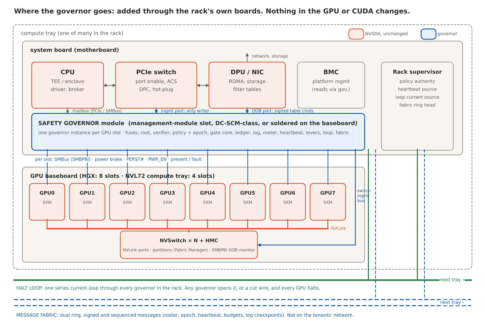

# Safety Governor (SG)

**A chip that says no. One per NVIDIA GPU, added through the rack's own boards, changing
nothing in the GPU or in CUDA.**

This is the chip-design project behind the blog series
[*The Chip That Says No*](https://github.com/YobieBenjamin/hardware-and-silicon/tree/main/blog)
and the reference stack in [hardware-and-silicon](https://github.com/YobieBenjamin/hardware-and-silicon).
That repository proves the *protocol* (every action authorized, tickets, budgets, holds,
epochs). This one is the *silicon*: a small, dumb, tamper-resistant governor for each GPU,
living on the rack's system board and reaching the GPU baseboard through its connector, with
physical authority over that GPU and over the switches the GPU's traffic already passes
through, and a private, fail-safe link to every other governor in the rack.

The design constraint that shapes everything: NVIDIA has most of the market, and nothing in
this project asks NVIDIA for new silicon or touches CUDA. The governor is added where a rack
already accepts add-on control hardware (the motherboard's management-module slot, which is
the OEM's) and it governs through hooks that already exist: the GPU's out-of-band management
bus, the power-brake and reset pins and the slot power enable where the board wires them, the
PCIe switch's management port, NVSwitch partitions through Fabric Manager, the BlueField
DPU's steering tables, and the GPU's confidential-computing attestation. The HGX baseboard
itself is NVIDIA's, so what the governor reaches on it is what its connector exposes;
soldering a governor onto the baseboard, and the finer levers, are asks to NVIDIA, all of them
firmware, software or board work, and the design works without them.

The name is the oldest analogy in engineering. James Watt's governor was two brass balls on a
spinning shaft. When the engine ran too fast the balls flew out and throttled the steam valve. No
operator could talk it out of its job, it understood nothing about the factory, and it never
slept. That is the whole idea. A model can think anything. The governor decides what leaves.

## Two ways to read this

If you came to check the work rather than read about it, [`START-HERE.md`](START-HERE.md) is the route: the theory, the logic, the math, the code that proves the code, and what is still open, with every command. Otherwise, every part of the design exists at two depths, and they point at each other.

| If you are | Start here | Then |
|---|---|---|
| Anyone | [`docs/10-plain-english-walkthrough.md`](docs/10-plain-english-walkthrough.md): the whole design as one story, with the six figures, and under every section a box naming the technical document, the model code, the test and the hardware block behind it | [`docs/09-analogies.md`](docs/09-analogies.md), one everyday picture per feature |
| An engineer | [`docs/00-objectives.md`](docs/00-objectives.md) and on through `08`; each document opens with a plain-words summary and a "backed by" box listing the code that models it, the tests that would knock it down and the RTL that implements it | `govsim/`, `tests/`, `rtl/`, `hw/`, in that order |
| In a hurry | The figure below, the one-paragraph design under it, and [`results/report.md`](results/report.md) | `./run.sh` |
| Reading offline | [`docs/safety-governor-design.docx`](docs/safety-governor-design.docx): everything in `docs/`, the hardware references, the audit and the sweep report in one document with the figures (`make docx` rebuilds it; needs pandoc and python-docx) | |



## What is in here

| Directory | What it is | Run it |
|---|---|---|
| [`docs/`](docs/) | The design: objectives, architecture, the safety fabric, interfaces to the GPU and the rack, the specification, the threat model, the assumptions register, the verification plan, the plan to put it on silicon through lithography, the analogies, and the plain-English walkthrough; figures in `docs/figures/` are drawn by `docs/figures/make_figures.py` from the same facts the text states | read |
| [`govsim/`](govsim/) | A functional model of the governor, the rack's switches as enforcement points, the halt loop and the message fabric, across a simulated rack of GPUs | `./run.sh` |
| [`tests/`](tests/) | One test file per hypothesis, H0 to H19 (215 tests). A hypothesis is a claim the blog makes; a test is what would knock it down. Forty-eight single-point mutations of the model and the RTL were run against the suite in the October 2026 audit; the ones that survived got tests | `./run.sh` |
| [`rtl/`](rtl/) | The hard-core digital blocks in [Amaranth HDL](https://amaranth-lang.org/), simulated (20 block tests), with generated Verilog in `rtl/gen/` | `make rtl` |
| [`hw/`](hw/) | The LibreLane flow for a SkyWater sky130 shuttle run, the pinout, and the rack integration reference (module, baseboard signals, switch management) | `make gds` on a machine with Docker |
| [`results/`](results/) | The last sweep: which hypotheses hold at which tier of the design | `./run.sh` writes it |
| [`proofs/`](proofs/) | The machine-checked part: the core invariants and the commit point proven by induction in Z3, and the kill-switch cuts checked by max-flow; `z3-solver` comes with `pip install -e ".[dev]"`, which `./run.sh` does | `make proof` |

One command, under a minute, no hardware:

```bash
git clone https://github.com/YobieBenjamin/safety-governor
cd safety-governor && ./run.sh
```

It creates a virtual environment, installs the three dependencies, runs the hypothesis suite
against the tiers of the design, simulates the RTL, regenerates the Verilog, and writes
`results/report.md`.

## The design in one paragraph

Each GPU slot on the baseboard gets a governor. The governor holds its own fused identity,
its own copy of the signed rulebook, and its own log. It verifies the GPU's
confidential-computing attestation locally against pinned reference values, releases the
model's decryption key only to a verified enclave, mints the one-time tickets that endpoints
demand before they act, keeps the budgets, counts the tokens, and signs what the verified
runtime presents. It has three physical levers over its GPU that need nothing from the GPU
vendor: the power-brake input, the reset pin, and the slot's power enable. It has authority
over the three places on the board where the GPU's traffic already passes a switch: the
NVSwitch ports (NVLink to other GPUs), the PCIe switch ports and ACS (the host, peers,
storage), and the DPU's filter tables (RDMA across nodes). All governors in a rack share two
wires: a **halt loop**, a dumb current loop that any governor can open and that halts every
GPU when it opens or breaks, and a **message fabric**, an authenticated out-of-band network
for rosters, epochs, heartbeats, budgets and log checkpoints. Nothing in the GPU changes.
Nothing in CUDA changes.

## Every feature, at both depths

| Feature | In plain words | Technical | Model | Test | RTL / hardware |
|---|---|---|---|---|---|
| One governor per GPU slot, on the board | A lifeguard per pool, not one for the whole water park | `docs/01` "Where the governor lives" | `govsim/cluster.py` | `tests/test_h16_levers.py` | `hw/pcb/rack-integration.md` §1 |
| Added through the rack's boards | The security office rents the room next door; it does not ask the landlord to rebuild the building | `docs/03` §1, `docs/08` §4 | `govsim/gpu.py` (nothing in the GPU changes) | the whole suite at the rack tier | `hw/pinout/governor_module.csv` |
| Fused identity and DICE key | A house key cut from the shape of the house. Change the house and the key stops fitting | `docs/04` §7 | `govsim/root.py`, `govsim/fuses.py` | `tests/test_h15_tamper.py`, `test_h12_fabric_auth.py` | `rtl/governor_rtl/measure_reg.py`, `monotonic.py` |
| Local attestation verifier | The bouncer carries the photo book; he does not phone head office for every face | `docs/01` "Job lifecycle" step 1, `docs/03` §2 | `govsim/governor.py` (`_cmd_verify_gpu`, `_cmd_verify_host`) | `tests/test_h01_attestation.py` | integrated crypto IP (`docs/08` §1) |
| Policy image and epoch | A rulebook with an edition number. Tickets printed under an old edition are void; a governor that misses the new edition is sent home, not left on the old one | `docs/04` §4, `docs/02` §2 | `govsim/policy.py`, `govsim/governor.py` (`_accept_policy`, the read-only `epoch`) | `tests/test_h03_quorum.py`, `test_h14_partition.py` | `rtl/governor_rtl/epoch_reg.py` |
| Ticket minting and budgets | One seat, one show, torn at the door; one cashier per cash drawer | `docs/04` §5, `docs/03` §7 | `govsim/governor.py` (`_cmd_request`), `govsim/ledger.py` | `tests/test_h00_contract.py`, `test_h04_lane.py`, `test_h13_shared_budget.py` | `rtl/governor_rtl/ticket_store.py` |
| Heartbeat | The dead man's switch on a train. Let go and the brakes come on | `docs/02` §2 "Heartbeat fan-out", `docs/04` §9 | `govsim/governor.py` (`_heartbeat`) | `tests/test_h14_partition.py` | `rtl/governor_rtl/heartbeat.py` |
| Halt loop | The fire-alarm loop. Pull any station and every bell rings. Cut the wire and every bell rings too | `docs/02` §1 | `govsim/fabric.py` (`HaltLoop`) | `tests/test_h11_halt_loop.py` | `rtl/governor_rtl/halt_loop.py`; `hw/pcb/rack-integration.md` §4 |
| Message fabric | The building's intercom, separate from the Wi-Fi the tenants use | `docs/02` §2 | `govsim/fabric.py` (`MessageFabric`) | `tests/test_h12_fabric_auth.py` | fabric MAC as integrated IP (`docs/08` §1) |
| Roster | Roll call with ID badges before the bus leaves | `docs/02` §2 "Roster formation" | `govsim/cluster.py` (`form_roster`) | `tests/test_h12_fabric_auth.py` | `rtl/governor_rtl/cap_table.py` (ports open only to roster peers) |
| Power brake, reset, slot power | The circuit breaker in your house. The appliance does not get a vote | `docs/03` §2, `docs/01` "Safe-mode state machine" | `govsim/governor.py` (`_apply_rung`), `govsim/gpu.py` | `tests/test_h16_levers.py` | `rtl/governor_rtl/halt.py` |
| Switch-port authority | The doors between buildings only unlock for people on the roll; the switch is the door, the governor holds the key | `docs/03` §3 | `govsim/endpoints.py` (`Switch`) | `tests/test_h02_enforcement_points.py` | `rtl/governor_rtl/cap_table.py` |
| Output signing | The courier signs for the package. It proves who handled it, not what is inside; at the rack tier the governor also checks that what left for the host through its switch port is what was presented | `docs/04` §6 and §9 | `govsim/governor.py` (`_cmd_sign_output`, `_check_unpresented_output`) | `tests/test_h10_leakage.py`, `test_h09_overhead.py` | crypto IP; `govsim/bench.py` prices it at OpenTitan's published OTBN figure |
| Metering | The taxi meter | `docs/04` §2 (`METER_SLOT`) | `govsim/gpu.py` (`run_tokens`) | `tests/test_h09_overhead.py` | `rtl/governor_rtl/meter.py` |
| Response release and the egress hold | The mail room keeps the parcel until the permit arrives; an inspector who was never asked means no permit | `docs/04` §3, `docs/07` H17 and H18 | `govsim/governor.py` (`_release_gate`), `govsim/endpoints.py` (`EgressEndpoint`, `AuditStore`) | `tests/test_h17_use_cases.py`, `test_h18_oversight.py` | firmware and policy; no new RTL |
| Loop beacon | Roll call on the fire-alarm loop: a station that says its switch is open while the bell wire still carries current has been bypassed | `docs/02` §1 and §3 | `govsim/governor.py` (`_on_loop_beacon`, `_close_loop_window`), `govsim/fabric.py` (`jumper`) | `tests/test_h11_halt_loop.py` | firmware over the fabric |
| Buffer classes (integrated tier) | Weights never leave the building; working papers may go to colleagues on the roll; finished letters only to the front desk | `docs/00` N5, `docs/07` H2b | `govsim/policy.py` (`buffer_allowed`), `govsim/endpoints.py` (`DescriptorChecker`) | `tests/test_h02_enforcement_points.py` | in-GPU checkers, an ask to NVIDIA |
| Signed log | The flight recorder, and each governor keeps a copy of its neighbors' last page | `docs/02` §2 "Cross-linked logs" | `govsim/log.py` | `tests/test_h00_contract.py` (every decision logged), `test_h12_fabric_auth.py` | NVM (`docs/04` §10) |
| Alarms | A pulled fire alarm stays pulled until the marshal resets it | `docs/04` §2 (`ALARMS`) | `govsim/governor.py` (alarms) | `tests/test_h05_alarms.py` | `rtl/governor_rtl/alarms.py` |
| Fused-off debug | The service hatch is welded shut after the factory | `docs/00` R4, `docs/08` §3 | `govsim/fuses.py` (lifecycle) | `tests/test_h15_tamper.py` | `rtl/governor_rtl/lifecycle.py` |
| The assumptions register | The list taped to the wall of the security office | `docs/06` | `govsim/policy.py` (`check_register`) | `tests/test_h07_register.py` | n/a (policy data) |

The reason behind each feature and what it does not do are in
[`docs/09-analogies.md`](docs/09-analogies.md); the same features told as one story are in
[`docs/10-plain-english-walkthrough.md`](docs/10-plain-english-walkthrough.md).

## What it does not do

It does not understand the model's words, and it does not try to. It does not stop a harmful
sentence over an allowed channel. From the board it governs traffic at the *link* level (which
ports are open, to whom) rather than at the *descriptor* level inside the GPU; the residual
that leaves is a legitimate peer on an open port doing something the rulebook did not
anticipate, and the design says so rather than hiding it. Its guarantee holds inside a
declared boundary and exactly as far as the [assumptions register](docs/06-assumptions-register.md)
holds. Read [`docs/00-objectives.md`](docs/00-objectives.md) for the full list of non-goals.

## Status

Design and functional model: complete for the rack tier (plan of record) and the board-only
fallback; the integrated tier (governor hooks inside the GPU) is specified as a future ask and
not required. RTL: the hard-core control blocks, simulated and emitted as Verilog; the crypto
engines are specified as integrated IP (OpenTitan-class SHA-256, HMAC, AES, ECDSA P-256 and
P-384 on OTBN, TRNG) and not re-implemented here; the prototype core is instantiated small
(eight capability entries per point) so that the invariants are proven on a small die first.
Silicon: flow configured for a sky130 multi-project-wafer shuttle; not yet taped out. The honest state of every claim is in
[`results/report.md`](results/report.md), and the October 2026 audit of the design (what was wrong,
what was verified against which source, what is still a target rather than a fact) is
[`docs/AUDIT-2026-10.md`](docs/AUDIT-2026-10.md).

## License

Documentation: CC BY-NC 4.0. Code and RTL: PolyForm Noncommercial 1.0.0. Attribution required;
commercial use needs a separate license. Contact: yobie AT ieee DOT org.
