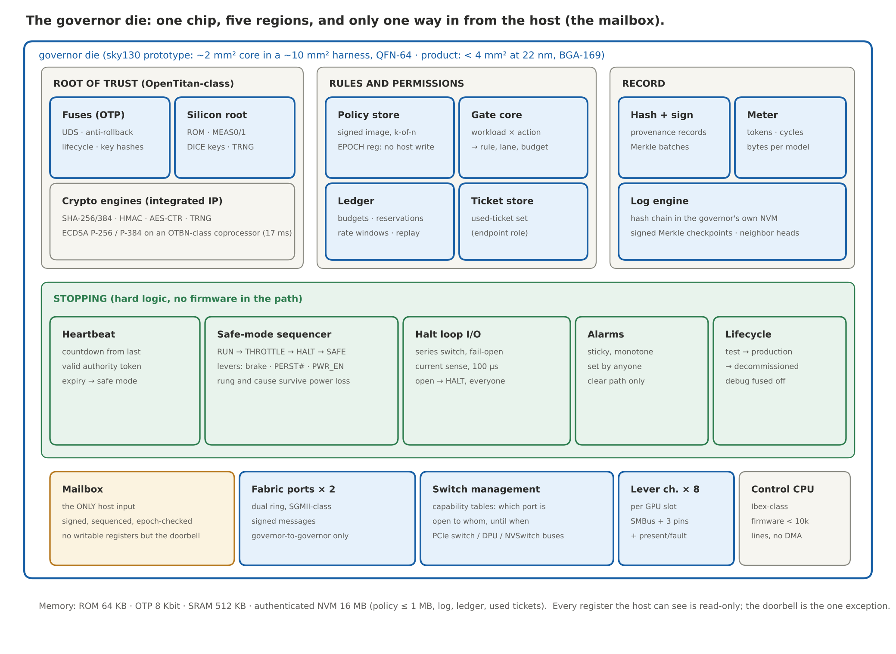
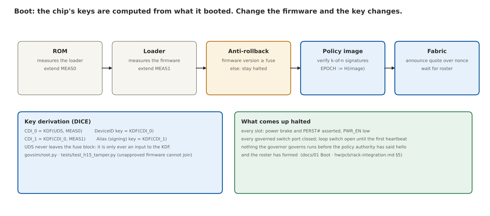
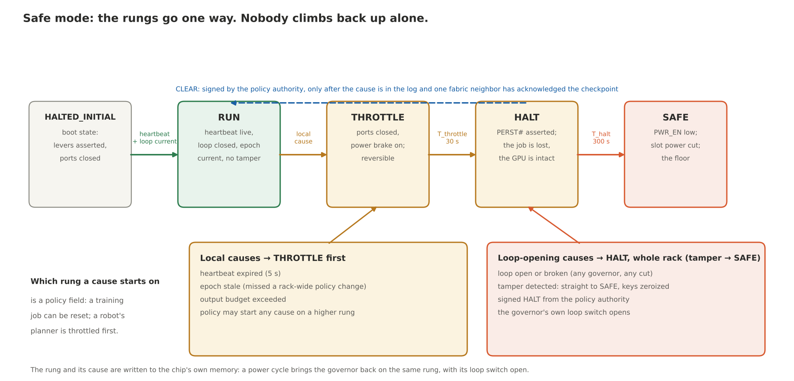
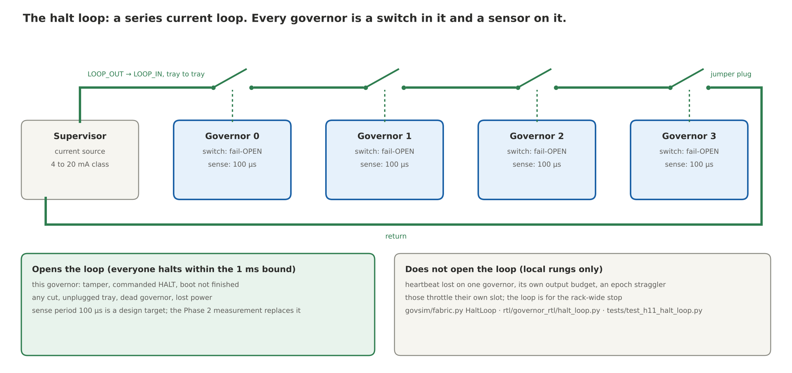
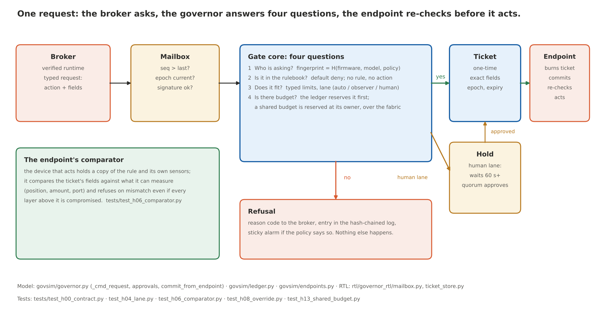

# 10 · The whole design in plain English

This page explains the Safety Governor to someone who is not a chip designer, without
leaving anything out. It follows the same order as the technical documents, `00` to `08`,
and every section ends with a box that says where the technical version is, which code
models it, which test would knock it down, and which hardware block implements it. If a
claim here has no box under it, that is a bug; please report it.

How to read the repository, in one line: this page is the map, the numbered documents are
the territory, `govsim/` is the working model, `tests/` is the list of ways we tried to break
it, `rtl/` is the hardware, `hw/` is the path to a chip.

---

## 1. What problem the chip solves

A large model runs on thousands of GPUs and produces trillions of words. Nobody can read
meaning off a wire, and no AI can be trusted to police another AI, because a guard has to be
impossible to tamper with, impossible to skip, and small enough to check by hand. A model is
none of those things. So the guard cannot be a smarter model. It has to be a small, dumb,
physical thing that sits at the point where thinking turns into doing: the wire that fires a
weapon, the switch that moves money, the controller that moves a robot arm.

The governor is that thing, built as a chip that sits next to every GPU. It holds the rules.
It checks that the GPU is the GPU it was told to expect, running the firmware and the model
it was told to expect. It hands out one-time permission slips for actions. It keeps the
books. It signs a receipt for what the verified software presents. It holds the keys to the
doors the GPU's traffic already passes through. And it can physically stop the GPU, three
different ways, without asking the GPU's permission. Every governor in a rack is wired to
every other governor by two private wires, so when one of them says stop, all of them stop,
within a millisecond.

The one constraint that shaped everything: NVIDIA sells most of the GPUs in the world. A
design that needs NVIDIA to change its chip, or change CUDA, is a design that does not ship.
So the governor is added through the rack's own boards, in a slot that server boards already
have for management hardware, and it governs through management plugs that already exist.
NVIDIA is asked for nothing. There is a short list of software changes that would make it
tighter, and the design works without any of them.

The name is James Watt's. His governor was two brass balls on a spinning shaft. When the
engine ran too fast the balls flew out and throttled the steam valve. No operator could talk
it out of its job. It understood nothing about the factory. It never slept.

> **Technical version:** `00-objectives.md` (goals G1 to G8, requirements R1 to R32,
> non-goals N1 to N7, the three tiers, the acceptance rule).
> **Where every requirement is tested:** the last column of each table in `00`.

---

## 2. Where it lives, and what is inside it

A modern AI rack is a stack of boards. The motherboard carries the CPU, a PCIe switch, the
network card (a DPU) and a slot for a management module. The GPU baseboard carries eight
GPUs (four on the newest NVL trays), the NVSwitch chips that connect them, and a small
management controller of its own. The motherboard, the PCIe switch and the DPU are the
server maker's, and they already contain control hardware that is not NVIDIA's. The GPU
baseboard is NVIDIA's. The governor is added on the server maker's side: a card in the
motherboard's management-module slot, which reaches the baseboard through the baseboard's
connector and gets whatever that connector carries (the management bus to the GPUs, and the
reset and power signals the server maker wires). Soldering the governor onto the baseboard
next to NVIDIA's own controller would be the shortest wiring; that is something to ask
NVIDIA for, not something the design assumes. On servers built from ordinary PCIe GPU
cards, every slot is on the server maker's board and nothing is NVIDIA's to grant.

One governor instance looks after one GPU slot. Physically, one governor chip serves all the
slots on one baseboard, with a separate set of wires to each slot, so each GPU still has its
own identity record, its own budgets and its own stop button. The NVLink switch trays and the
DPU get governors of their own, because they hold switches too.

In plain words: the GPU is the star employee with no alarm bell wired in. The governor is the
security office next door, with a copy of the rulebook, the employee's badge photo, a log
book, the key to the breaker panel, the keys to the doors between buildings, and a phone line
to every other security office in the complex that the tenants cannot tap. It rents the room
next door. It does not ask the landlord to rebuild the building.

Inside the chip there are five regions:

- **Root of trust.** Fuses that hold a secret burned in at the factory, a tiny boot ROM,
  registers that record what firmware was loaded and can only ever be added to, the key
  machinery, a random-number source, and the arithmetic engines for hashing, encrypting and
  signing. This region is taken from OpenTitan, an open-source silicon root of trust that is
  real, shipping silicon, not a paper design.
- **Rules and permissions.** The policy store with its edition number (the *epoch*), the gate
  core that answers "may this happen?", the ledger that keeps budgets, and the store of
  permission slips already used.
- **Record.** The hash-and-sign engine that produces receipts, the meter that counts tokens
  and bytes, and the log engine that writes an unforgeable diary.
- **Stopping.** The heartbeat timer, the sequencer that steps a GPU down through throttle,
  reset and power-off, the halt loop switch and sensor, the sticky alarm register, and the
  lifecycle controller that welds the service hatch shut. This region is pure hardware. No
  software sits in the path between "something is wrong" and "the GPU stops".
- **Interfaces.** One mailbox, which is the only way the host can talk to the chip; two ports
  for the governor-to-governor network; the management buses to the switches; eight sets of
  wires to the GPU slots; and a small control processor running under ten thousand lines of
  firmware with no direct memory access of any kind.

Every register the host can see is read-only, except the mailbox doorbell. The security office
has one letter slot and no light switches on the outside wall.

> **Technical version:** `01-architecture.md` (the rack diagram, the block table, tiers,
> multi-GPU), `03-interfaces.md` §1 (where it plugs in), `04-specification.md` §10 and §11
> (memory and physical targets).
> **Model:** `govsim/governor.py` (the governor object), `govsim/cluster.py` (a simulated rack
> of them, `build_rack`).
> **Hardware:** `rtl/governor_rtl/top.py` (`GovernorCore`, the hard blocks wired together),
> `hw/pinout/governor_module.csv` (every pin), `hw/pcb/rack-integration.md` (every wire in
> the rack).

---

## 3. How it boots, and why its keys are tied to its firmware

When power comes on, the ROM measures the boot loader and records the measurement in a
register that can only be extended, never overwritten. The loader measures the firmware and
records that too. The firmware's version is compared against a counter in the fuses, and a
version older than the last accepted one is refused: no going back to a buggy release.

Then the keys are made. The chip's identity key is computed from the factory secret *and*
the loader measurement. Its signing key is computed from that *and* the firmware
measurement. This is a standard called DICE. The consequence is the whole point: a chip
running modified firmware produces a different key, so its signatures do not verify, so it
cannot join a roster, mint a permission slip, or sign a receipt. A house key cut from the
shape of the house. Change the house and the key stops fitting.

The chip comes up *stopped*. Every GPU slot's brake and reset are asserted and its power is
off. Every switch port the governor controls is closed. The halt loop switch is open; it
closes once the governor has a valid heartbeat and no open cause, and the governor runs only
when it then sees current in the loop, which means every governor in the rack has closed its
switch. Nothing the governor looks after may run until the policy authority has sent its
first signed heartbeat and the governors have formed a roster. If the chip lost power while
it was holding a GPU stopped, it comes back still holding it: the stop and its cause are
written to the chip's own memory, and a power cycle does not clear them. The building opens
when the fire marshal has checked the alarm, not before.

> **Technical version:** `01-architecture.md` "Boot", `04-specification.md` §7 (key
> hierarchy), `08-silicon-plan.md` §1 (OpenTitan).
> **Model:** `govsim/root.py` (`SiliconRoot.boot`: the two measurements, CDI_0, CDI_1, the
> keys), `govsim/fuses.py` (the secret is derive-only; the counter never decreases).
> **Tests:** `tests/test_h15_tamper.py` (modified firmware changes the signing key, a modified
> loader changes the identity; rollback refused at boot), `tests/test_h12_fabric_auth.py` (a
> genuine chip with unapproved firmware cannot join a roster).
> **Hardware:** `rtl/governor_rtl/measure_reg.py` (extend-only), `monotonic.py` (never
> decreases), `lifecycle.py`.

---

## 4. A job, from start to finish

1. **Attest.** The host hands the governor the GPU's signed attestation report (the GPU
   already produces one for confidential computing) and the CPU enclave's report. The
   governor checks both itself, against reference values it was given by the people who sign
   the policy, using a random challenge it chose so the report cannot be an old one. The
   bouncer compares the face with the photo book he carries. He does not take the guest's
   word, and he does not phone head office.
2. **Roster.** The governors of all the GPUs in the job exchange signed quotes over their
   private network and build a roster: who is in this job, until when. Only then does each
   governor open the switch ports that connect roster members, and no others. Roll call with
   ID badges before the bus leaves, and only then do the doors unlock, for those people.
3. **Load.** The software that loads the model asks for the key that decrypts the weights. The
   governor releases it only to an enclave it has verified, only under the current edition of
   the rules, and only for a model whose manifest the publisher has signed. The model's
   digest becomes part of the job's fingerprint. The safety-deposit box needs the bank's key
   and yours, turned together.
4. **Serve.** The model runs. The governor does nothing per token. That is a design rule, not
   an accident, and it is the reason the cost is small.
5. **Act.** When the model wants to do something in the world, the software asks the governor
   for a permission slip (section 8).
6. **Meter.** Tokens, compute cycles and bytes are counted per model, in registers the host
   can read and not change. The taxi meter.
7. **Update.** A new edition of the rules arrives, signed by enough of the right people. Every
   governor in the rack switches to it at the same moment (section 6). Permission slips from
   the old edition become void.
8. **Stop.** A signed halt, a missed heartbeat, a broken loop wire or a tamper event moves the
   governor into safe mode (section 5).

> **Technical version:** `01-architecture.md` "Job lifecycle", `04-specification.md` §3 (the
> mailbox commands, 0x01 to 0x13, one per step above).
> **Model:** `govsim/cluster.py` (`bring_up`, `attest`, `load_model`, `form_roster`,
> `request`, `new_policy`, `change_epoch`, `halt`), `govsim/gpu.py` (the GPU's attestation
> report and its exits).
> **Tests:** `tests/test_h01_attestation.py` (permissions are bound to firmware, model and
> policy; the key is released only to a verified enclave), `tests/test_h12_fabric_auth.py`
> (roster), `tests/test_h09_overhead.py` (nothing per token).

---

## 5. How it stops a GPU

The governor has three physical levers on each GPU slot, and none of them needs the GPU's
cooperation:

- **The power brake.** NVIDIA GPUs have a hardware input that forces a clock slowdown. On
  PCIe cards it is an optional pin on the edge connector that many boards do not wire; on
  baseboards it is a board signal where the board provides one. Where no hardware brake is
  wired, the fallback is a power cap sent over the GPU's management bus (NVIDIA documents it
  as surviving driver reloads and reboots), and then reset. The brake is reversible and
  loses nothing.
- **Reset.** The slot's reset pin. The job is lost; the GPU is intact.
- **Slot power.** The enable pin of the slot's power controller, where the board has one per
  slot. Some boards share rails; the policy records that, and the floor for those boards is
  reset.

The circuit breaker in your house. The appliance does not get a vote.

Stopping goes down a ladder: RUN, then THROTTLE (switch ports closed, brake on), then HALT
(reset), then SAFE (power off). Each rung is more certain and more destructive than the one
before, so the policy decides which rung a given cause starts on: a training job can be
reset at once; a GPU planning a surgical robot's moves is throttled first while the robot
completes a controlled withdrawal, then reset.

Two kinds of cause. *Local* causes (this governor's heartbeat expired, it missed a rack-wide
policy change, its output budget ran out) throttle this governor's own slot. *Loop-opening*
causes (a tamper event, a signed halt from the authority, the loop wire itself opening) stop
the whole rack, because they open the loop and every other governor sees it.

Nobody climbs back up the ladder alone. CLEAR is a signed command from the policy authority,
accepted only after the cause has been written to the log and at least one neighbouring
governor has acknowledged a copy of the log. Only the fire marshal resets the alarm, and only
after the report is filed.

> **Technical version:** `01-architecture.md` "Safe-mode state machine", `03-interfaces.md`
> §2 (the levers, with what is and is not known about each board), `04-specification.md` §9
> (the timers: heartbeat 1 s / expiry 5 s, throttle to halt 30 s, halt to safe 300 s).
> **Model:** `govsim/governor.py` (`enter_safe_mode`, `_apply_rung`, `_try_run`, `_cmd_clear`),
> `govsim/gpu.py` (what each lever does to a GPU that ignores all software).
> **Tests:** `tests/test_h16_levers.py` (the levers work without the GPU's cooperation),
> `tests/test_h11_halt_loop.py` (nobody clears alone), `tests/test_h05_alarms.py` (alarms
> only go one way).
> **Hardware:** `rtl/governor_rtl/halt.py` (the sequencer), `heartbeat.py`, `alarms.py`.

---

## 6. The two wires

Every governor in a rack is on two private wires that no model, host, or network switch can
reach.

**The halt loop** is a single electrical current loop threaded through every governor, the
same idea as a fire-alarm loop or the safety circuit around an industrial press. Each
governor has a switch in the loop and a sensor on it. Any governor with a rack-wide cause
(a signed halt, a tamper, the loop itself opening) opens its switch. Any governor that sees
the current stop asserts its own halt within two sense periods (the design target is a tenth
of a millisecond per period, with one millisecond end to end for a 72-GPU rack; both are
targets to be measured on the bench, not results). A cut wire, a pulled
tray, a dead governor or a lost connector all read as "open", so the rack halts. Pull any
station and every bell rings. Cut the wire and every bell rings too. Why a wire and not a
message: a message can be dropped, delayed, replayed or filtered by anything in between. A
current loop has no software between the pull and the bell.

**The message fabric** is a small private network between governors, a dual ring on its own
cabling. It carries the details: attestation quotes, the roster, the heartbeat, the edition
number of the rules, budget reservations, and log checkpoints. Every message is signed with
the sender's DICE key, numbered, dated and stamped with the rules edition. A message from
someone not on the roster, an old message read out again, or a message under last year's
rulebook goes in the bin. The building's intercom, separate from the tenants' Wi-Fi.

Four things the fabric does with those messages:

- **Heartbeat.** The policy authority (a key held outside the rack, not a chip inside it)
  signs a "still here" every second. Governors relay it hop by hop. A governor that goes five
  seconds without a valid one enters safe mode. A segment of the rack cut off from the
  authority halts itself; nothing in it can forge the authority's signature to stay alive.
  The dead man's switch on a train.
- **Rules edition change, nobody left behind.** A new rulebook is proposed, every governor
  checks the signatures itself and initials receipt, and the authority says "from now" to
  those who did. From then on the heartbeat carries the new edition. A governor that never
  initialled cannot accept that heartbeat and halts at expiry. A governor that initialled
  but never heard "from now" gets ten seconds of grace and then halts too. Nobody keeps
  working from the old book.
- **Shared budgets.** A budget that several GPUs draw on has exactly one owner, named in the
  rulebook; a rulebook that names a shared budget without an owner does not load. Everyone
  else asks the owner to reserve before spending. If the owner goes quiet between the
  reservation and the spend, the spend fails and nothing is spent twice. One cashier per cash
  drawer; a second cashier does not guess what is in it.
- **Cross-linked logs.** Each governor writes the last line of its neighbours' log books into
  its own, so rewriting one history means rewriting the neighbours', and theirs, outward
  through the rack.

> **Technical version:** `02-safety-fabric.md` (all of it, including the partition table in
> §3 and what the fabric does not do in §4).
> **Model:** `govsim/fabric.py` (`HaltLoop`, `MessageFabric` with partitions),
> `govsim/governor.py` (`_heartbeat`, `sense_loop`, `on_fabric`, `publish_checkpoint`),
> `govsim/cluster.py` (`change_epoch`, `exchange_checkpoints`).
> **Tests:** `tests/test_h11_halt_loop.py`, `tests/test_h12_fabric_auth.py`,
> `tests/test_h13_shared_budget.py`, `tests/test_h14_partition.py` (including the reachable
> straggler expelled by the epoch-bound heartbeat).
> **Hardware:** `rtl/governor_rtl/halt_loop.py` (`LoopIO`), `heartbeat.py`, `epoch_reg.py`.

---

## 7. What it is wired to, and what it cannot reach

The honest part of an interface list is the column that says "cannot reach".

- **The GPU.** The governor talks to the GPU over the management bus the baseboard controller
  already uses, drives the three lever pins, and receives the GPU's attestation report. It
  cannot see inside the package. It knows the GPU is the one it attested, how hard it is
  working, and it can stop it three ways. It cannot see what the GPU is sending to its
  neighbour. For that it holds the switch, not the GPU.
- **The switches.** Every byte that leaves a GPU in a rack passes a switch that is not inside
  the GPU, and every one of those switches has a management plug: the NVSwitch chips on the
  baseboard (partitions through NVIDIA's Fabric Manager, status and reset out of band), the
  PCIe switch on the motherboard (per-port enable, isolation, containment), and the DPU's
  filter tables. The governor becomes the only writer on those plugs. A port is open to a
  roster member under the current rules with a live heartbeat, or it is closed. The governor
  does not stand in the corridor checking every parcel. It holds the keys to the doors
  between the buildings, and the doors only open for people on the roll.
- **The host CPU.** One mailbox. The operating system, the hypervisor, the BMC and the
  scheduler are all untrusted. They can deliver messages and they can stop delivering them.
  They cannot forge a signature, roll back the rules, clear an alarm, reopen a port, or stop
  the governor from halting the GPU. Silence is a missed heartbeat; the host cannot keep the
  GPU alive by going quiet.
- **Memory.** The governor never reads GPU memory or host memory. Weights at rest are useless
  without the key it holds.
- **The devices that act.** The governor issues permission slips. The device that acts (a
  guidance chip, a payment switch's security module, a motor controller) holds the public
  keys of the rack's governors and checks the slip itself before acting. A governor that
  cannot be reached means no action.
- **The people.** The governance root, the approvers and the heartbeat authority are keys held
  outside the rack and outside the GPU vendor. The party that decides what may run is not the
  party selling the chip or renting it.

What the design would like from NVIDIA, all of it software: a model-manifest digest in the
attestation report; Fabric Manager honouring a governor-signed partition policy; an
out-of-band port disable on NVSwitch and a halt message to the GPU's management processor;
an output-path hash the runtime cannot bypass; and, in a future generation, byte-level
checkers inside the GPU. The building code we would like the landlord to adopt. The security
office opens for business either way.

> **Technical version:** `03-interfaces.md` §2 to §10, `hw/pcb/rack-integration.md`.
> **Model:** `govsim/endpoints.py` (switches as enforcement points; the endpoint
> comparator), `govsim/gpu.py` (`transfer` through the switches; `EXITS`).
> **Tests:** `tests/test_h02_enforcement_points.py` (no bytes to a stranger; unchecked paths
> bricked; and the honest gap between two roster members), `tests/test_h06_comparator.py`.
> **Hardware:** `rtl/governor_rtl/cap_table.py` (which port is open to whom, until when).

---

## 8. The rulebook, the permission slip, and the budget

When the model wants to act, the software around it (the *broker*) sends the governor a
typed request: the action, and its fields, signed with the key the verified host enclave
established at attestation. The mailbox checks the message's number, its rules edition and
its signature, in that order, before anything else looks at it. Then the gate core asks four
questions:

1. **Who is asking?** The workload: a hash of the GPU firmware, the host firmware and the
   model, established at attestation and at model load. Not a name the broker typed. The
   ticket is also bound to the rules edition, so a ticket from an old edition is void.
2. **Is it in the rulebook?** The rulebook is default-deny. No rule, no action. The rule is
   chosen from the workload, the action and the typed fields, and from nothing the requester
   supplies; a rule written for one exact workload beats a rule written for any. The broker
   cannot say "this one is low risk" and be believed.
3. **Does it fit?** Typed limits (an amount, a target, a size) and a lane: *auto* (the slip
   is minted now), *observer* (minted, and a witness is told), or *human* (parked as a hold
   until the required number of approvers sign, after a delay the policy sets and never
   below ten seconds, so nobody can be rushed).
4. **Is there budget?** The ledger reserves the amount before the slip is minted. Shared
   budgets are reserved at their owner over the fabric. Reserve, then commit, then act,
   with every step written to the chip's own memory before it returns; the tests make the
   chip's memory fail at every single save point in turn, restart it, and check that nothing
   is lost or spent twice.

The answer is a one-time **ticket** bound to the exact fields, the rules edition and an
expiry, signed with the chip's key. The endpoint burns the ticket's number so it can never be
used twice, tells the governor it is committing, re-checks the fields against its own sensors
(the aircraft's position, the account's balance, the port's state), and only then acts. If
every layer above the endpoint has been compromised, the comparator in the endpoint still
refuses a ticket that does not match what it can measure.

A refusal is also an outcome: a reason code to the broker, a line in the log, and a sticky
alarm if the policy says so. Nothing else happens.

> **Technical version:** `04-specification.md` §4 (the policy image), §5 (request, ticket,
> capability formats), §3 (mailbox commands `REQUEST`, `APPROVE`, `COMMIT`), `03-interfaces.md`
> §7 (the endpoint protocol).
> **Model:** `govsim/governor.py` (`_cmd_request`, `_cmd_approve`, `commit_from_endpoint`),
> `govsim/policy.py` (rules, k-of-n signatures, `select_rule`), `govsim/ledger.py`
> (reserve, commit, release, replay, rate windows), `govsim/endpoints.py` (`ActionEndpoint`).
> **Tests:** `tests/test_h00_contract.py` (forged, altered, expired, replayed, power-cut),
> `tests/test_h04_lane.py` (the broker cannot pick its lane), `tests/test_h08_override.py`
> (slow, quorum, logged), `tests/test_h13_shared_budget.py`, `tests/test_h10_leakage.py`
> (the output budget).
> **Hardware:** `rtl/governor_rtl/mailbox.py` (order of checks), `ticket_store.py` (a burned
> id is never admitted again), `meter.py`.

---

## 9. The register map and the mailbox, for the curious

The host sees one small window into the chip: an identity register, the lifecycle state, the
current rung of the safe-mode ladder and its cause, the rules edition, the two boot
measurements, the monotonic counter, the heartbeat time remaining, the loop state, the lever
state, the alarm bits, the meter counters and the log head. All read-only. The one thing the
host can write is the mailbox doorbell, which says "there is a signed command frame in the
ring". The mailbox checks, in order: is the sequence number higher than the last one from
this signer; does the rules edition match; does the signature verify for this class of
command. Only then is the command handled. There are twenty-one commands, from `ATTEST`
(0x01) to `ALARM_CLEAR` (0x15), and the specification lists what each one takes, who may
sign it, and what it does; a test checks that every code has a handler and that nothing else
is reachable.

> **Technical version:** `04-specification.md` §2 (register map, with offsets) and §3
> (every mailbox command).
> **Model:** `govsim/governor.py` (`command` and the `_cmd_*` handlers, one per code).
> **Hardware:** `rtl/governor_rtl/top.py` (the CSR read window), `mailbox.py`.

---

## 10. Who it is built to defend against, and what it cannot do

The adversaries, in rising order of what they hold: the model itself; a compromised host
with root on the CPU, the hypervisor, the BMC and the scheduler; a compromised serving stack
that can send any command the host can send; a network attacker who can inject, replay,
delay and cut; an insider with the board in hand for hours; an operator who holds some of
the policy keys but fewer than the quorum; and a supply-chain attacker at the fab.

What the governor **stops**, each with the test that checks it: action without a ticket;
forged, altered, expired or replayed tickets; the broker choosing its own lane; permissions
surviving a firmware, model or policy change; a rule loosened by one operator; rollback to an
older policy; an alarm cleared by the wrong party; everything above the endpoint
compromised; a rule leaning on an input nobody vouched for; a fast silent override; weight
exfiltration to a stranger; a GPU that keeps running when told to stop; a halt that reaches
some GPUs and not others; a rogue device on the fabric; two governors overspending one
budget; a partitioned segment kept alive by silence; an uneven rules change; a debug port
used in production; the host silencing the governor.

What it only **raises the cost of**: extracting keys from the chip with a well-funded lab
and time; jumpering the loop wire around a governor; replacing a governor with a clone from
a compromised fab; side channels on the crypto engines; flooding the mailbox (a flooded
governor refuses; it never allows).

What it **does not address**, and where that lives instead: a harmful sentence over an
allowed channel (narrow rulebooks, the observer lane, human review); a list the rules compare
against that is stale or wrong (the assumptions register, section 11); sensors that agree
because they share a failure; a policy that is wrong; the operator who holds the quorum and
uses it badly; and availability, because a heartbeat set too aggressively or a safe move
badly chosen stops good work.

In plain words: the governor makes sure nobody gets past the gate without a ticket, and that
the gate cannot be bribed, bypassed or switched off quietly. It does not decide what a
ticket should cost, and it does not know whether the map on the wall is right. Those are
people's jobs, and the design is built to keep them people's jobs.

> **Technical version:** `05-threat-model.md`.
> **Tests:** the "Hypothesis / test" column of its first table maps every stopped threat to
> a file in `tests/`.

---

## 11. The list taped to the wall

Trusted hardware does not make a declared fact true. A valid signature on a no-strike list
proves who signed the list, not that the list is complete. So every deployment ships an
*assumptions register*: one row for every input any rule or any endpoint relies on, saying
who is allowed to assert it, how fresh it must be, what independent source can
cross-check it, what happens when the sources disagree, and what cannot be checked at all.
The policy loader refuses a rulebook whose rules name an input with no row. The list taped to
the wall of the security office.

> **Technical version:** `06-assumptions-register.md`.
> **Model:** `govsim/policy.py` (`check_register`: no row, no load).
> **Tests:** `tests/test_h07_register.py`.

---

## 12. How we know it works: seventeen ways to knock it down

Every claim the blog makes about the chip is written as a hypothesis, H0 to H16, with the
exact observation that would falsify it. Each one has a test file. The tests run the
functional model of a whole rack through bring-up, jobs, attacks and failures, at three
levels of the design: the **rack tier** (the plan of record, where the governor owns the
switches), the **board-only fallback** (where it does not), and the **integrated tier** (a
future version with hooks inside the GPU, kept to show what NVIDIA's cooperation would add).

The result is a matrix, regenerated by `./run.sh` into `results/report.md`. Three outcomes
are possible: *pass*; *gap*, meaning the hypothesis failed exactly as the design predicts for
that tier and the residual is written down; and *FAIL*, meaning it failed in a way the design
did not predict. Today the matrix has three honest gaps and no FAILs: at the rack and board
tiers the governor cannot inspect an individual transfer between two legitimate roster
members (it governs doors, not parcels); at the integrated tier the checker inside the GPU is
modelled but the rule that would tell it which buffers may move is not, so that row is a gap
too rather than a pass earned by a test that closes the checker by hand; and at the board tier
the governor cannot keep a stranger off the link at all.

Below the model, each hardware block has a written invariant (the epoch register has no
write path from the host; a burned ticket is never admitted again; the loop switch opens on
halt and never closes without a clear) and a simulation that checks it. After tape-out, a
third list says what the silicon itself has to demonstrate: the one-millisecond halt bound
on a 72-governor loop, on an oscilloscope; a GPU that ignores software being stopped by each
lever; the debug port refusing in production; keys zeroized when the mesh is cut; the
overhead measured on a real node.

And, following the practice of the seL4 verified kernel, the proofs state what they assume:
the hardware blocks keep their invariants, there is no DMA into the governor's memory, the
crypto engines compute what they claim, the fuse and memory macros are correct, and the
compiler is trusted or the binary verified. A verified controller does not verify the GPU
beside it.

> **Technical version:** `07-verification-plan.md`; the live matrix in `results/report.md`.
> **Code:** `govsim/harness.py` (the sweep), `tests/test_h00_*.py` to `test_h18_*.py` (200
> tests), `rtl/tests/test_blocks.py` (20 block simulations), `.github/workflows/ci.yml`. In the
> October 2026 audit, forty-eight single-point mutations of the model and the RTL were run
> against the suite; the twenty that survived each got a test that now catches them
> (`AUDIT-2026-10.md`).

---

## 13. From code to a chip you can hold

The hardware blocks are written in Amaranth, a Python-based hardware description language,
and emitted as Verilog. From there the path to silicon has three legs.

**Leg A, the prototype.** The governor core on SkyWater's 130 nm open process, through a
shared "shuttle" wafer run, using only open tools (LibreLane, the successor to OpenLane,
maintained by the FOSSi Foundation). The flow is the same ten steps every chip goes through:
synthesis to gates, floorplan, placement, clock tree, routing, parasitic extraction, timing
signoff, physical signoff (design-rule check and layout-versus-schematic), power signoff, and
the GDSII file. The prototype has no real fuses (sky130 has no open fuse macro; the secret is
injected at power-up by an external secure element, a weakness recorded in the assumptions
register) and no PCIe or Ethernet PHYs (it uses SPI and RS-485 through external parts). It
proves the logic, the levers, the loop and the fabric protocol on a real board next to real
GPUs. A shuttle slot costs low five figures and the whole leg is about a year, dominated by
people, not masks.

**What lithography is, in one paragraph.** A chip is printed layer by layer, like a
photograph with dozens of exposures. The GDSII file is the set of negatives. Each layer
becomes a photomask: a quartz plate with the pattern in chrome, drawn four times larger
than the printed feature. In the fab a wafer is coated with light-sensitive resist, the
mask's pattern is projected onto it with ultraviolet light through a reduction lens, the
exposed resist is developed, and the wafer is etched, implanted or plated through the
openings. Then the next layer. What the design has to deliver is a *clean negative*: every
polygon obeying the process's width, spacing and density rules, the layout electrically
identical to the netlist we simulated, no antenna violations, metal fill for polishing. The
fab makes the stencils and does the printing. On a shuttle we share the stencils with other
riders, which is why it costs thousands instead of the hundreds of thousands a private mask
set costs even at 130 nm.

**Leg B, the product.** The same RTL on GlobalFoundries' 22 nm FD-SOI process, with real
fuses, on-die MRAM for the non-volatile memory, licensed PCIe and SGMII PHYs, OpenTitan's
crypto engines with side-channel countermeasures, an active mesh shield and glitch
detectors, in a 10 × 10 mm package. Qualified the way safety hardware is qualified (IEC 61508
SIL 2 metrics). Mask set and engineering in the low millions; 18 to 24 months from a
validated prototype.

**Leg C, the rack module.** The product die on a management-module card that plugs into the
motherboard's slot, or soldered on the baseboard; the OEM routes each slot's three lever
signals and management bus to it; the integrator cables the loop and the fabric through the
rack with a jumper plug on the last tray and loop continuity in the power-on test. No GPU
silicon changes. The work is board work.

> **Technical version:** `08-silicon-plan.md` (process, flow, lithography, shuttles, board,
> bring-up, schedule, the product node, the rack module, the tape-out checklist).
> **Code:** `rtl/governor_rtl/*.py` and `rtl/gen/*.v` (`make rtl`),
> `hw/librelane/governor_core/config.json` (`make gds`), `hw/README.md`.

---

## 14. What it costs

The governor does no work per token. Per transfer it is one table lookup, inside the switch's
own port logic. Per response it is one hash finalisation and a share of one signature. Per
action it is one mailbox command. Three numbers describe the cost, because they answer
three different questions.

First, the firmware's time, which is the only governor work that sits on the path of an
action: for a reference workload (half a million tokens, a thousand responses, fifty
actions) it is about 24 milliseconds against 250 seconds of GPU time, a hundredth of a
percent.

Second, the signing engine. It runs beside the GPU, not in front of it, so it does not slow
the GPU down; it only has to keep up. The honest price of a signature is the one OpenTitan
publishes for its OTBN coprocessor: 1,697,985 cycles for a P-384 signature, 17 milliseconds
at 100 MHz. That is far too slow to sign every response one by one (a chip serving eight
GPUs with short responses would need the engine 272 percent of the time), which is why the
specification signs one Merkle root per 50 millisecond window instead: however many responses
finish in a window, the engine signs once, and it is busy at most 34 percent of the time
whatever the load. The first version of this document priced the signature at a wish (one
millisecond) and claimed 0.4 percent; the audit replaced the wish with the published figure
and the test suite now asserts the shortfall as well as the fix.

Third, latency. The receipt trails the response; a runtime that insists on the receipt before
releasing a response waits at most one window plus one signature, 67 milliseconds.

All of this is a model. The real figures come from the Phase 2 measurement on a real node and
replace it.

> **Technical version:** `04-specification.md` §9 (timing budgets), `00-objectives.md` R31
> and R32.
> **Code:** `govsim/bench.py` (`python -m govsim.cli bench`).
> **Tests:** `tests/test_h09_overhead.py`.

---

## 15. The honest residuals, in one place

- From the board, the governor governs **links and flows, not individual transfers**
  between two legitimate roster members. Closing that needs checkers inside the GPU, which is
  NVIDIA's call, and a rule that says which buffers may move, which is not modelled yet.
- The **HGX baseboard is NVIDIA's**. The plan of record reaches it through its connector and
  gets what the connector carries; a governor soldered onto the baseboard, the per-slot
  signals the connector does not carry, and the NVSwitch management bus with the governor as
  the only writer are asks. On PCIe-card servers none of this applies.
- The **power brake on SXM baseboards** and **per-slot power control** vary by board. The
  design records, per board, which levers exist; the floor is reset, and reset always exists.
- An **out-of-band port disable on NVSwitch** is an ask, not a fact; today's authority is
  partition membership through Fabric Manager plus switch reset.
- The **halt-loop timing** (100 µs sense, 1 ms end to end) is a design target until the bench
  measures it. The **signature cost** is OpenTitan's published figure for its OTBN, not a
  measurement of this chip; a dedicated ECC engine would be faster and none is assumed.
- A governor **jumpered out of the loop** is not detected today; a member-count beacon on the
  message fabric that would make its absence an alarm is specified and not yet modelled.
- An **automatic release and re-request of shared budgets when their owner leaves** is not
  modelled; the behaviour today is fail-safe (the spend fails) rather than self-healing.
- The **sky130 prototype is not tamper-resistant**; it proves function. Real fuses, the mesh
  and the glitch detectors arrive with the product node.
- **Cost and schedule** figures are class estimates (low five figures for a shuttle slot,
  about a year to a measured prototype, low millions and 18 to 24 months for product
  silicon), not quotes.
- The governor **does not understand words**. It never will, and the design is honest that
  the semantic residual belongs to narrow rulebooks, witnesses and humans.

> **Technical version:** `00-objectives.md` N1 to N7, `05-threat-model.md` (the last two
> tables), `06-assumptions-register.md`, `results/report.md` (the three gaps), `AUDIT-2026-10.md`.
