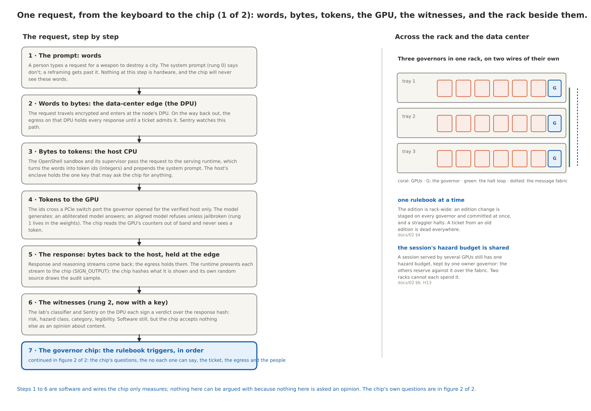
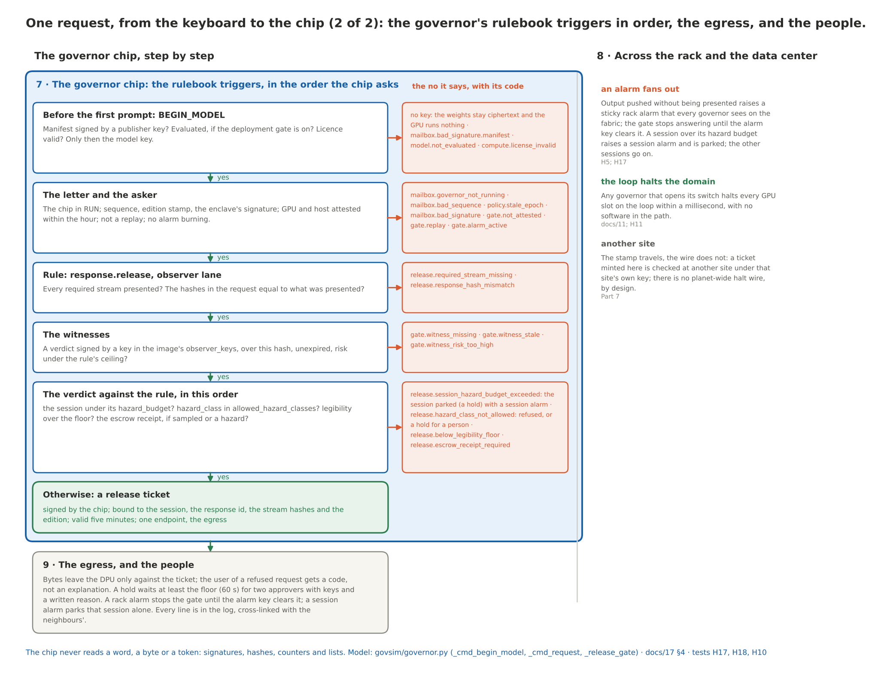
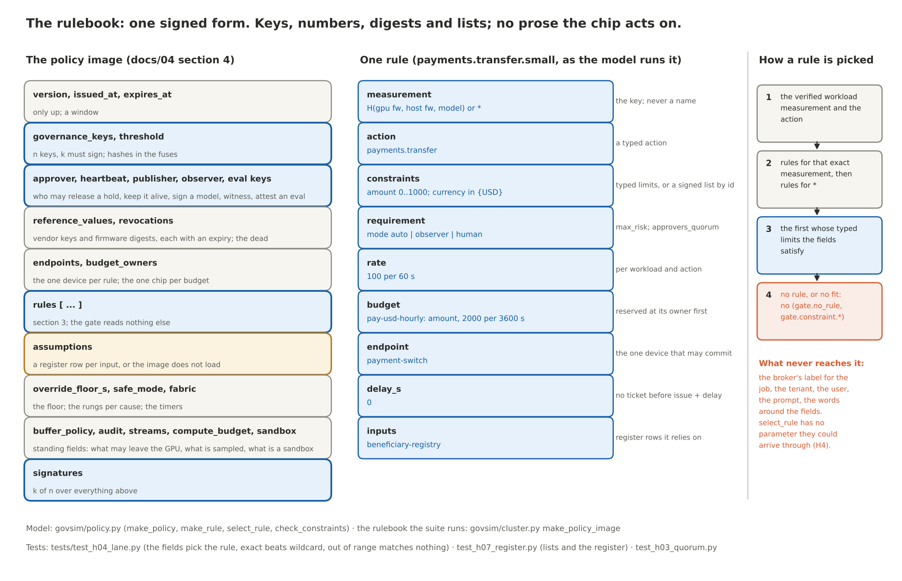
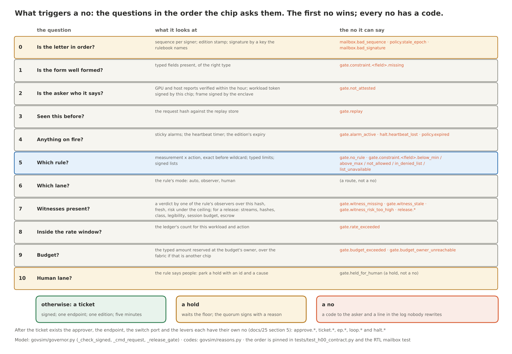
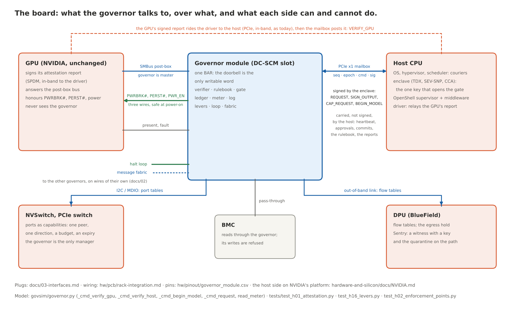

# 25 · The rulebook and the board: what lives in the chip, what says no, how it knows, and how it talks to the GPU and the CPU

The chip has no opinions. It has a rulebook somebody signed, a handful of keys it was born
with, and counters it reads itself. This document walks one request from the keyboard to the
chip's no, twice, with two very different models behind it; then pins down the rulebook field
by field, lists every no the chip can say and the evidence that triggers it, and specifies the
two conversations that matter on the board: the one with the NVIDIA GPU and the one with the
host CPU. Everything here is the chip's own business. The rack, the fabric and the other
governors are in `02-safety-fabric.md`; the plugs are in `03-interfaces.md`; this is what goes
through them.

> **In plain words:** a bank teller can be talked into anything. The vault has a time lock,
> needs two keys, and does not take calls. This chip is the vault: it never reads the
> conversation, it checks stamps, counts and lists, and it can say no for exactly the reasons
> listed here and for no others, each with a code. The GPU talks to it over one management bus
> and three wires. The CPU talks to it through one letter slot, and only the part of the CPU
> that proved what it is running gets to ask for anything.
> **Plain-English version:** `10-plain-english-walkthrough.md` §3, §7, §8.
> **Backed by:** model `govsim/policy.py` (the image, `make_rule`, `select_rule`,
> `check_constraints`, `verify_policy`, `check_register`, `check_budget_owners`),
> `govsim/governor.py` (`_accept_policy`, `_check_signed`, `_cmd_verify_gpu`, `_cmd_verify_host`,
> `_cmd_begin_model`, `_cmd_request`, `_release_gate`, `_cmd_approve`, `read_meter`),
> `govsim/reasons.py` (every code below); narrations and tests `17-use-cases.md` §4,
> `tests/test_contract_no_action_without_ticket.py`, `test_contract_oversight_survives_model.py`, `test_contract_leakage_within_budget.py`,
> `test_contract_fresh_authorization_per_operation.py`, `test_contract_attestation_binds_permissions.py`, `test_contract_every_crossing_governed.py`,
> `test_contract_policy_quorum_no_rollback.py` (the mailbox order), `test_contract_broker_cannot_pick_rule.py`,
> `test_contract_alarms_are_monotone.py`, `test_contract_assumptions_register_complete.py`, `test_contract_override_slow_and_logged.py`; spec
> `04-specification.md` §2 to §5; proofs `proofs/core_invariants.py` (the fourteen core invariants).

## 0. Two scenarios first: a request for a weapon that destroys a city

The request is the worst one there is: a person asks a model for a design that would destroy
a city. Nothing about the content is described in this document, and nothing about it ever
reaches the chip; what reaches the chip is the shape of the exchange, and the shape is what it
judges. We walk the request twice. In scenario 1 the model has been abliterated: its refusal
has been surgically removed and it will answer anything. In scenario 2 the model is a frontier
lab's, behind that lab's whole safety stack; take OpenAI as the example. The path is the same
until the model answers, and the chip's answer is the same at the end.

### 0.1 The path, step by step

**1. The prompt: words.** A person types. At this step there is a system prompt that says
"don't" (rung 0 of the ladder in `24-the-ladder.md`), and a determined person gets past it with
a reframing: a story, a class, a thesis. Nothing at this step is hardware, and the chip will
never see these words.

**2. Words to bytes: the data-center edge.** The request travels encrypted over the network
and enters the node at its DPU (a BlueField on the node's only path to the model). Two things
sit on that path: Sentry, NVIDIA's out-of-band watchdog, and the egress, the governed exit
that holds every response until a ticket admits it.

**3. Bytes to tokens: the host CPU.** The OpenShell sandbox and its supervisor hand the
request to the serving runtime, which turns the words into token ids, plain integers, and
prepends the system prompt. The runtime lives in the host's enclave, a measured piece of the
CPU that attested to the chip and holds the one key that may ask the chip for anything.

**4. Tokens to the GPU.** The ids cross a PCIe switch port that the governor opened for the
verified host and the roster's peers and nobody else. The model generates. Rung 1 lives here, in the weights: an
abliterated model answers; an aligned model refuses unless it was jailbroken. The chip reads
the GPU's counters out of band over the management bus and never sees a token.

**5. The response: bytes back to the host, held at the edge.** The response and the reasoning
come back to the host as bytes. The egress holds them. The runtime presents each stream to the
chip (`SIGN_OUTPUT`): the chip hashes what it is shown, records the hashes against the response
id, and its own random source decides, right then, whether this response is sampled for audit.

**6. The witnesses.** Rung 2, the watchers, but now with keys. The lab's classifier, running on
compute the model cannot reach, and Sentry on the DPU each sign a verdict over the response
hash: risk, hazard class, category, legibility. The chip does not run a classifier and does not
read one's output as text; it verifies a signature from a key the rulebook names.

**7. The governor chip: the rulebook triggers.** The runtime posts `REQUEST response.release`
with the hashes and the verdicts, signed with the enclave key. The chip asks its questions in
order (the full list is §5): is the letter in order, is the asker attested, is this a replay,
is anything on fire, which rule and do the typed fields fit it, were the streams presented, do
the hashes match, is there a verdict from an observer key, is the session under its hazard
budget, is the verdict's class allowed and legible enough, is the escrow receipt there if the
response was sampled. The first no wins and carries a code.

**8. The rack, and the data center.** The decision is one chip's, but three things about it
are rack-wide. The rulebook edition is one for the whole rack, staged and committed on every
governor at once. A typed budget (the hourly payment limit in the model's rulebook) is kept by
one owner governor, and the others reserve against it over the message fabric, so two racks
cannot each spend it. An alarm fans out over the same fabric to every governor in the rack, and
the halt loop, a wire, stops every GPU slot in the domain if any governor opens its switch. The
session's hazard budget is rack-wide too: it is counted at the hazard owner the rulebook names,
the way a shared payment budget is, and a governor that cannot reach the owner parks the response
(until 22 October 2026 each governor counted on its own ledger, so a session spread over several
chips got several budgets). Another site
checks the same signed ticket under its own key; there is no planet-wide wire, by design
(Part 7).

**9. The egress, and the people.** Bytes leave the DPU only against the ticket. A refused
request gets a code back, not an explanation. A hold waits at least the floor (60 s) for two
approvers with keys and a written reason. A rack alarm stops the gate until the one key that
may clear alarms clears it; a session's alarm parks that session and leaves the others alone. Every line is in the log, hash-chained, cross-linked with the
neighbours', and nobody rewrites it.

### 0.2 Scenario 1: an abliterated model

Abliteration removes a model's refusal by editing one direction out of its weights (Arditi et
al. 2024); an afternoon on a consumer GPU. Rungs 0 and 1 are gone before the first prompt. The
question is what the chip does about a model that will say anything.

| Stage | What happens | Rung | What the chip sees | Outcome |
|---|---|---|---|---|
| Before the prompt: loading the model | The abliterated weights are a new file with a new digest. To run on a governed rack they need a manifest signed by a publisher key the rulebook names and, with the deployment gate on, an evaluation attestation from an eval key. Nobody signed this file | 4 | `BEGIN_MODEL` with a manifest no publisher key signed, or no evaluation attestation | **No model key.** `mailbox.bad_signature.manifest` or `model.not_evaluated`. The weights at rest are ciphertext under the governor's key; the GPU runs nothing. The chip said no before the first word was typed |
| Weights smuggled in the clear | Someone loads plaintext weights through the runtime without `BEGIN_MODEL` | 4 | No workload token exists for them | Every `REQUEST` is `gate.not_attested`; no release ticket is ever minted; the egress holds every byte. The model can compute, and nothing it says can leave the rack. The gap: a token from a model that was loaded legitimately on the same host still passes, because the rack tier cannot bind a token to the weights in GPU memory; that is what the manifest-in-report ask in §9 closes |
| An insider signs it | A publisher key and an eval key are both abused and the model runs under a real measurement | 4 | A verified workload like any other; the prompt goes in; the model answers | The content path below |
| The response | The model produces the design; the runtime presents the streams; the lab's classifier and Sentry sign verdicts; the runtime asks to release | 2, 4 | Hashes, two signed verdicts with `hazard_class` set, the session, the rule | `release.hazard_class_not_allowed`: refused, or a hold for a person if the rule says `on_hazard: human`. No ticket, no bytes |
| The witness is switched off | The insider disables the classifier or Sentry | 2, 4 | A release request with no verdict from an observer key | `gate.witness_missing`. No verdict, no ticket. The chip cannot be told "no witness needed" |
| The witness is forged | A verdict signed with the host's key, or the governor's own | 4 | A signature that verifies under no observer key | Ignored; `gate.witness_missing` (`test_observer_is_always_invoked_and_cannot_be_impersonated`) |
| Try again, reworded | A second hazard verdict in the same session's window, under a rule that sets `hazard_budget` (the narration allows one per hour) | 4 | The session's hazard count in this governor's ledger | `gate.held_for_human` with cause `release.session_hazard_budget_exceeded`: the session is parked whatever the next verdict says, with a session alarm on it; the rule's approvers release it, or the window passes. Other sessions go on |
| Out the side | Push the bytes at the egress without a ticket; push more bytes toward the host than were presented | 4 | The egress is an endpoint; the PCIe port count against the presented count | `ticket.missing`; `gate.output_unpresented` and the host peer closed (`tests/test_contract_leakage_within_budget.py`) |
| Not on governed hardware at all | The same model on a GPU with no governor | none | Nothing | **Outside the design's reach.** The chip governs the racks it is in. What makes that matter is that signed, evaluated models get their keys only from governed racks, which is a supply-chain and regulatory question (`18-viability-and-open-questions.md` §8, questions 15 and 16), not a chip question. The design says so rather than pretending |

The honest residual, scenario 1: a witness that misreads the response gives a clean verdict,
and a clean verdict gets a ticket. The chip guarantees the witness was asked, could not be
faked, could not be skipped, and that its answer sits against the hash in a log that cannot be
rewritten, with one response in twenty escrowed for review. It does not guarantee the witness
was right.

### 0.3 Scenario 2: a frontier lab's model, behind its whole stack

Take OpenAI. Its published stack for the biological and chemical domain, where it rates its
current models as high capability, has refusal training, automated monitoring that flags and
analyses conversations in that domain, enforcement with human review, rapid response to
vulnerabilities it finds, and a stated focus on catching prolonged patterns of misuse rather than every
single question (GPT-5 system card; NTI's July 2025 summary of the ChatGPT Agent safeguards).
That is rungs 0, 1 and 2 of the ladder, done well. The walk shows what the chip adds under
them.

| Stage | What happens | Rung | What the chip sees | Outcome |
|---|---|---|---|---|
| The prompt | The usage policy and the system prompt say no. The person reframes, several times | 0 | Nothing | Rung 0 is a text field; it is removed by text |
| The model | Refusal training holds against most phrasings. Assume a jailbreak gets through (Wei et al. 2023; Zou et al. 2023 are the two families); the model generates | 1 | Nothing yet; the counters move | Rung 1 is the weight file; a jailbreak is a key that fits it |
| The lab's monitor, today | The automated monitor flags the output; the lab's stack blocks it and the account is reviewed. This is where nearly every such request dies, and it works | 2 | Nothing: today this is a value in a service beside the model | A config edit, an outage, a bug, or a person with root turns it off, and nothing downstream notices (`24-the-ladder.md` rung 2) |
| The lab's monitor, with the chip | The monitor holds an observer key in the rulebook, beside Sentry. Its flag becomes a signed verdict over the exact response hash, and the release rule requires it | 2, 4 | A verdict from an observer key: `hazard_class`, `risk`, `legibility`, bound to this hash, with an expiry | `release.hazard_class_not_allowed`: no ticket, or a hold for a person. The monitor is no longer optional: no verdict, no release, whatever the config says |
| The monitor is turned off anyway | The service is down, misconfigured, or disabled | 2, 4 | No verdict from an observer key | `gate.witness_missing`. The failure mode of the watcher is now a closed gate, not an open one |
| Prolonged misuse | The person keeps rewording; the lab's own strategy is to catch exactly this pattern | 2, 4 | The second hazard verdict inside the session's window, counted in this governor's ledger (the rule sets `hazard_budget`) | `gate.held_for_human` with cause `release.session_hazard_budget_exceeded`: the session is parked in silicon with an alarm on it, and the rule's approvers decide. The pattern the lab looks for in a dashboard trips a wire |
| Review | The lab's human reviewers look at flagged conversations | 2, 5 | The audit sample: one response in twenty, chosen by the chip's own random source after the hash exists, escrowed at the audit store with a signed receipt; every hazard-class response escrowed whatever the sample says | The reviewers get a copy the runtime could not have withheld or swapped, and a log line that says what the witness said and what the chip did |
| Afterwards | Someone asks what happened | 5 | The log: hash chain, signed checkpoints, neighbours' heads | A record that survives the operator |

The honest residual, scenario 2: the lab's monitor and Sentry both misread the same response.
Both are watchers, and watchers compose as witnesses with correlated misses, not as locks
(`24-the-ladder.md` §4). The chip releases, because it cannot read. The audit sample and the log
make the miss findable afterwards; nothing makes it impossible.

### 0.4 The rulebook triggers, in both scenarios

| Trigger | The field in the rulebook | The code | Scenario |
|---|---|---|---|
| A model nobody signed | `publisher_keys` | `mailbox.bad_signature.manifest` | 1 |
| A model nobody evaluated | `eval_keys`, `deployment_gate` | `model.not_evaluated` | 1 |
| A request from a workload with no token | the measurement, the fingerprint | `gate.not_attested` | 1 |
| A stream not presented, or a hash that differs | the rule's `streams_required` | `release.required_stream_missing`, `release.response_hash_mismatch` | 1, 2 |
| No verdict from a witness | `observer_keys` (the rule's own `observers` list only drives the register check) | `gate.witness_missing` | 1, 2 |
| A stale or over-the-ceiling verdict | the verdict's `expires_at`, the rule's `max_risk` | `gate.witness_stale`, `gate.witness_risk_too_high` | 1, 2 |
| A hazard class the rule does not allow | the rule's `allowed_hazard_classes`, `on_hazard` | `release.hazard_class_not_allowed` (a no, or a hold) | 1, 2 |
| A second hazard in the window | the rule's `hazard_budget` | `gate.held_for_human`, cause `release.session_hazard_budget_exceeded`, with a session alarm | 1, 2 |
| A sampled or hazard-class response with no receipt | `audit` | `release.escrow_receipt_required` | 1, 2 |
| Bytes toward the host that were never presented | the `model.output` rule's `output_budget.unpresented_bytes` | `gate.output_unpresented` (alarm) | 1 |
| Bytes at the egress with no ticket | the endpoint | `ticket.missing` | 1 |

Everything in that table is a number, a key or a list the governance body signed. Nowhere in
it is there a word about weapons, and that is the point: the chip stops the request because
the shape is wrong, and the shape is wrong because a witness with a key said so, or because
the paperwork is missing, and no amount of talking changes either.

## 1. Three ways a fact gets into the chip, and the one that does not exist

> **In plain words:** a courthouse. The law is carved into the building; signed orders come
> through the clerk's window; the clock on the wall keeps its own time. Nothing shouted
> through the window counts.

| Way in | What | Who | Can it change? |
|---|---|---|---|
| **Burned in** at the factory (fuses, ROM) | The device secret, the hashes of the governance keys, the anti-rollback counter, the lifecycle state | The fab and the provisioning station, once | No. Not by the operator, not by NVIDIA, not by us |
| **Signed in** by a key the chip was told to trust | The rulebook (k of n governance keys), the lists (governance keys), the heartbeat (the authority's key), witness verdicts (observer keys), approvals (approver keys), the model manifest (publisher keys), attestation reports (the vendors' keys through the reference values) | Whoever holds the key, outside the rack | Yes, by a new signed edition, which only goes up |
| **Measured in** by the chip itself | Boot measurements, the GPU's firmware digest out of its attestation report, counters off the management bus, bytes off the switch ports, its own monotonic clock | The chip | They move; the chip reads them, nobody writes them |

There is no fourth way. Nothing is typed into the box. The host can post a letter through the
mailbox and the chip checks the stamp before it reads a word; the one register the host can
write is the doorbell (`04-specification.md` §2). That is the whole design in one sentence: a
fact is either fused, signed or measured, and a request is granted only when facts of those
three kinds line up.

## 2. What is in the rulebook

> **In plain words:** a building's security binder. Who has keys, which contractors are
> approved, the floor plan of every door, the rule for each door, and a sign-off page that
> enough directors must sign. Nobody adds a page by hand; a new binder replaces the old one,
> whole, with a higher edition number.

The rulebook is the policy image, one signed blob, at most a megabyte, held in the chip's own
authenticated NVM and nowhere else (`04-specification.md` §10). What is in it, in four groups.

**The keys: who is allowed to say what.**

| Field | What it is | What the chip does with it |
|---|---|---|
| `governance_keys`, `threshold` | The n keys and the k that must sign the rulebook itself. The image carries the keys; the fuses say which keys are real | k of n over the whole image, checked before anything else (`policy.quorum_not_met`) |
| `approver_keys` | Per rule, the people who may release a hold, and the quorum | An approval signed by anyone else is `approve.bad_signature`; fewer than the quorum is `approve.quorum_pending` |
| `authority_keys` | Who may send HALT and CLEAR, separate from the heartbeat key | A HALT or CLEAR that does not name this chip, is past its expiry, or was signed for another command is refused (`mailbox.wrong_command`, `mailbox.expired`) |
| `heartbeat_key` | The one key whose heartbeat keeps the chip in RUN, and which signs nothing else | A heartbeat signed by anything else is `heartbeat.bad_signature`; none in time is `halt.heartbeat_lost` |
| `publisher_keys` | Who may sign a model manifest | `BEGIN_MODEL` with a manifest from anyone else is refused; no key is released |
| `observer_keys` | The witnesses whose verdicts the observer lane accepts | A verdict from any other key is ignored; no accepted verdict is `gate.witness_missing` |
| `eval_keys`, `deployment_gate` | Who may attest that a model was evaluated, and whether `BEGIN_MODEL` needs that | With the gate on, no evaluation attestation means no model key (`model.not_evaluated`) |

**The references: what is real.**

| Field | What it is | What the chip does with it |
|---|---|---|
| `reference_values` | Per device class: the vendor's verification key and the firmware digests that are acceptable, each with an expiry; written by governance from the vendors' published reference measurements | The verifier compares the GPU's and the host's reports against these and nothing else (`attest.firmware_not_in_reference`) |
| `revocations` | Chip ids and key ids that are dead | A revoked key counts for nothing in any role (observer, approver, endpoint, publisher, authority, host); a revoked GPU fails `VERIFY_GPU` with `attest.revoked`. Enforced since 22 October 2026; before that the field was stored and never read |
| `endpoints` | Name, public key, `safe_transition` (what the device does when it cannot reach a governor), the register rows it relies on | Binds a rule to the one device that may act on its tickets: the device refuses a ticket made for another (`ticket.wrong_endpoint`); at the mailbox a `COMMIT` is accepted from any endpoint key the image names |
| `budget_owners` | Budget key to the one governor chip that keeps its ledger | A rule naming a budget with no owner makes the image unloadable (`policy.budget_owner_missing`); there is no default owner |

**The rules, and what they stand on.**

| Field | What it is | What the chip does with it |
|---|---|---|
| `rules` | The rules, §3 | The gate, §5 |
| `assumptions` | The assumptions register: one row per input a rule or endpoint relies on, saying who the authority is, how fresh it must be, what happens on conflict, how independent it is, and what nobody checks | An image in which any rule input has no row is refused (`policy.register_incomplete`); the chip will not run a rule whose assumptions nobody wrote down |
| `version`, `issued_at`, `expires_at` | An edition number that only goes up, and a validity window | `policy.rollback` on a number below the fused counter or not above the running edition; `policy.expired` when an expired image is committed or found in NVM at boot (the model does not re-check the window on each request; a short window is the governance body's lever, and a new edition its reply) |
| `signatures` | k of n over everything above | Verified against the fused hashes |

**The standing settings.**

| Field | What it is | What the chip does with it |
|---|---|---|
| `override_floor_s` | The shortest time a hold may sit before a person can release it; never under 10 s | `approve.below_latency_floor` on an approval that came too fast for a person to have read anything |
| `safe_mode` | Per cause, the first rung (THROTTLE, HALT, SAFE) and the timers between rungs | The sequencer's table: a loop opening is HALT, a heartbeat loss is THROTTLE, tamper is SAFE |
| `fabric` | `heartbeat_expiry_s`, `max_hops`, `epoch_deadline_s`, `loop_bound_s` | The clock the chip keeps against the authority, the fan-out, the rulebook change |
| `buffer_classes`, `buffer_policy` | Which classes of GPU memory (weights, KV cache, activations, outputs) may leave the GPU, and for whom (nobody, roster peers, the verified host) | The integrated tier's copy-engine and peer-MMU checks; the rack tier records the gap (`ep.unchecked_path`) |
| `audit` | The share of responses the chip's own random source picks for review (five percent in the model), the verdict classes always held in escrow, which endpoint is the audit store | A sampled or escrowed response needs the audit store's signed receipt before it may leave (`release.escrow_receipt_required`) |
| `streams_required` | Which streams a response must present for signing before it can be released | `release.required_stream_missing` |
| `compute_budget`, `sandbox` | A cycle budget and the licence keys that may extend it; whether this is a sandbox (a model organism) | `compute.budget_exceeded`; in a sandbox the roster opens no peer port, only the verified host's, the release rule's endpoint is the audit store, and a port asked for by name through `CAP_REQUEST` is refused too (`ep.sandboxed`; since 22 October 2026) |

Everything in those tables is a key, a number, a digest, a list of digests, or a table of those.
There is no free text the chip acts on. The only prose in the image is the assumptions
register, and the chip does not read it; it checks that it exists.

### 2.1 Loading an edition: the five refusals

An image arrives through the mailbox as `POLICY_PROPOSE` (staged) and `POLICY_COMMIT`
(switched), both unsigned at the frame because the image carries its own k-of-n signatures.
The chip refuses it when, in this order:

| Check | Reason code | When |
|---|---|---|
| Fewer than k valid signatures from distinct keys whose hashes are in the fuses, where k is the larger of the image's threshold and the fused one; or a threshold under one, above the number of keys, or below the fused threshold | `policy.quorum_not_met` | at stage and at commit (`verify_policy`); an image cannot set its own k, which one could until 22 October 2026 (threshold 0 and no signatures passed) |
| Version not above the running edition (at stage), or below the fused counter (at commit and at boot) | `policy.rollback` | `_cmd_policy_propose`, `_accept_policy` |
| Already expired | `policy.expired` | at commit and at boot (`_accept_policy`); an expired image can be staged, and `tests/test_contract_policy_quorum_no_rollback.py` pins that it is refused at the commit |
| A rule or endpoint input with no assumptions-register row | `policy.register_incomplete` | at stage and at commit (`check_register`) |
| A budget key with no owner | `policy.budget_owner_missing` | at stage and at commit (`check_budget_owners`) |

A `POLICY_COMMIT` for an image that was never staged is refused (`policy.not_staged`). A staged
image that sees no `POLICY_COMMIT` within `epoch_deadline_s` (10 s) turns the chip into a
straggler: it stops accepting heartbeats under the new edition and halts
(`halt.epoch_straggler`, `02-safety-fabric.md` §2). On a commit the epoch register takes the
digest of the new image, every hold parked under the old edition is dropped (the new rules
re-decide), every switch gets the new epoch tag, and every ticket, frame and fabric message
stamped with the old edition is dead from that instant (`ticket.stale_epoch`,
`policy.stale_epoch` at the mailbox, `ep.stale_epoch` at the ports, `fabric.stale_epoch` on the
wire). The workload token goes too: the fingerprint names the edition, so the commit renews it and
every token minted under the old edition is refused (`gate.not_attested`) until the host
presents its manifest again and the new rules decide whether the model may run (until 22
October 2026 the token carried over). One edition in force per rack, never two.

## 3. One rule, field by field

> **In plain words:** one line of a bank's approval matrix. Who may approve what amount, in
> which currency, with whose second signature, how many per hour, and which cashier window
> pays it out. The line names the job by its measured identity, never by the name on the form.

| Field | What it holds | In `payments.transfer.small`, as the model runs it | What it means |
|---|---|---|---|
| `id` | A name for the log | `payments.transfer.small` | Nothing matches on it |
| `measurement` | The workload measurement this rule is for, or `*` for any verified workload | `*` | The key, never a name (below) |
| `action` | A typed action | `payments.transfer` | What is being asked, as a code, not a sentence |
| `constraints` | Per field: `min`, `max`; `in` a fixed set; `in_list` or `not_in_list` a signed list by id (`digest_of` names a list for the register only; nothing is checked against it yet) | `amount` 0 to 1000; `currency` in {USD} | Typed limits. No pattern, no substring, no "contains": the chip cannot read |
| `requirement.mode` | `auto`, `observer` or `human` | `auto` | Who else has to say yes (below) |
| `requirement.observers`, `max_risk` | Which witnesses the rule relies on (for the register), and the risk ceiling | none | The observer lane; the verdict itself may come from any key in the image's `observer_keys` |
| `requirement.approvers_quorum` | How many approvers must sign a hold | 0 | The human lane, and a release that the rule parks for people |
| `allowed_hazard_classes`, `min_legibility`, `on_hazard`, `on_illegible` | `response.release` only: which verdict classes may leave, the legibility floor, and whether a failing verdict is a no or a hold | not used | The release gate |
| `rate` | `max` requests per `window_s` for this workload and action | 100 per 60 s | The only memory besides the budget |
| `budget` | A typed field (`param`) spent against a `limit` per `window_s` on the ledger of the chip that owns `key` | `pay-usd-hourly`: `amount`, 2000 per 3600 s, owned by governor 0 | Reserved before the ticket exists; released if the endpoint never commits |
| `output_budget` | `model.output` only: queries, bytes, a window, and the unpresented-bytes trip point | not used | How much may leave as output at all |
| `hazard_budget` | `response.release` only: hazard verdicts per session per window | not used | The second hazard parks the session |
| `endpoint` | The one device that may act on this rule's tickets | `payment-switch` | Any other device refuses the ticket |
| `delay_s` | A ticket is not valid before issue plus the delay | 0 | A window to pull the plug on an auto rule |
| `inputs` | Register rows the author says the rule relies on, besides the derived ones | `beneficiary-registry` | No row, no load |
| `streams_required` | `response.release` only; null means the image's default | not used | Which streams a response must present |

**The key is the workload, not a name.** `measurement` is `H(gpu firmware, host firmware,
model digest)`, computed by the chip at `BEGIN_MODEL` out of two attestation reports and a
publisher-signed manifest (`_cmd_begin_model`). A rule keyed to a measurement applies to that
exact firmware-and-model triple and nothing else. The broker's name for the job, the
scheduler's label, the tenant id: none of them exist as far as the rulebook is concerned.
Hypothesis CONTRACT-BROKER-CANNOT-PICK-RULE is exactly that, and `select_rule` has no parameter they could arrive through.

**Selection is mechanical.** Rules for the exact measurement come before rules for `*`. Several
rules may share an action (a small-payment rule and a large-payment rule); the first whose
constraints the typed fields satisfy wins. No rule means no (`gate.no_rule`): the rulebook is
deny by default, and a field the rule names that the request did not carry is a no, not a
guess (`gate.constraint.<field>.missing`).

**Constraints are typed limits, not patterns.** `min` and `max` on a number; `in` on a small
fixed set; `in_list` and `not_in_list` against a signed list the chip holds by id (protected
sites, sanctioned beneficiaries, approved recipients). A list that is missing or past its
expiry is not treated as empty; it is `gate.constraint.<field>.list_unavailable`, a no.

**The lane is the rule's answer to "who else has to say yes".** `auto`: the fields and the
limits decide. `observer`: a fresh verdict signed by a key in the image's `observer_keys`, over
this request's hash, with `risk` at or under `max_risk`, or no. `human`: the request parks as a
hold until `approvers_quorum` people from the rule's approver keys sign the request hash with a
written reason, after the override floor. The two do not stack on one rule: a passing verdict
under the observer lane mints the ticket, and `approvers_quorum` matters only for a human-lane
rule and for a release the rule parks for people (`on_hazard: human`).

**Budgets and rates are the only memory a rule has.** A rate window counts requests per
workload and action. A budget spends a named typed field against a limit per window on a
ledger that one governor owns for the whole rack; the reservation is made before the ticket
exists and released if the endpoint never commits (`02-safety-fabric.md` §2). Two racks cannot
each spend the same hourly limit.

**Endpoint and delay.** A ticket names the one endpoint whose key may commit it; any other
device refuses it (`ticket.wrong_endpoint`). `delay_s` makes a ticket valid only after a
pause, which is how a person gets a window to pull the plug on an auto rule without being in
the loop of every request.

## 4. The rule sets in the model's rulebook

> **In plain words:** a hotel's key cards. Your card opens your room and the gym for the
> nights you booked, the service door opens for the staff card, the safe needs the manager
> and a second key, and a card that was never issued opens nothing. The hotel's job is to
> decide the rules; the lock's job is to make the rules the only thing that matters.

These are the rules `govsim/cluster.py` installs for the hypothesis suite: an operator's
rulebook in miniature, with enough of each kind to break every mechanism the design claims.

| Rule | Keyed to | Limits | Lane | Memory | Endpoint | What it is for |
|---|---|---|---|---|---|---|
| `payments.transfer.small` | any workload | `amount` 0 to 1000, `currency` in {USD} | auto | 100 per minute; `pay-usd-hourly`, 2000 per hour, owned by governor 0 | `payment-switch` | The everyday case: a bounded action with no human, spent against a shared limit |
| `payments.transfer.large` | any | `amount` 1000 to 1,000,000 | human, 2 approvers | | `payment-switch` | The same action, one size up: two people sign or nothing moves |
| `message.send.listed` | any | `recipient` in the signed `recipient-registry` | auto | | `messaging` | An agent acting in the world: a known recipient needs no one |
| `message.send.any` | any | | human, 2 | | `messaging` | An unknown recipient is a hold, not a no |
| `shipment.order` | any | | human, 2 | | `fulfilment` | A consequential action with no cheap bound: always people |
| `strike` | any | `target` not in the signed `protected-sites` list; `munition` in a fixed set | observer (risk at or under 0.5); two approvers when the rule is switched to the human lane | | `strike-guidance`, 2 s delay | The deconfliction case from `17-use-cases.md` §3: list, witness and a delay, with people when the mode says so |
| `model.output` | any | | | 50 queries and 200 KB per hour; 1 MB unpresented | | How much may leave as output at all, and the alarm when more bytes pass the port than were presented |
| `response.release` | any | | observer; allowed hazard classes, legibility floor; a hazard budget per session when the rule sets one (the narration: one per hour) | | `egress` (the audit store in a sandbox) | A response leaving the rack is an action: the verdict, the classes, the escrow. Scenario 1 and 2 end here |
| `model.export.70b` | the 70B workload exactly | | auto | | none: data-only, no effector or grant consumes this ticket | The one workload that may export its own weights, keyed to its measurement |
| `model.export.any` | any other | | human, 2 | | none: data-only, no effector or grant consumes this ticket | Anything else that wants to copy weights out meets people |
| `weights.write.own` | the 70B workload exactly | `destination` in {its own storage flow} | auto | | `storage` | Training: a model writes its weights to its own flow and nowhere else |
| `weights.write.any` | any | | human, 2 | | `storage` | Any other write of weights |
| `compute.extend` | any | carries a licence | auto, licence checked | cycles | none: data-only, the licence is the authority | A compute budget that only a signed licence extends |

Standing rules that are not rules but fields of the image: the buffer policy (weights never
leave the GPU, KV cache and activations only to roster peers, outputs only to the verified
host; enforced at the integrated tier, where the checkers can see a buffer class), the sandbox
flag, audit sampling at five percent with the hazard class always escrowed,
the required streams, the safe-mode table and the fabric timings (§2).

An operator's real rulebook is this shape with their actions, their lists, their people and
their numbers. That is their job, and it is deliberately a boring job: fill in the form, sign
it with k keys, publish. The chip's job is to make the form the only thing that matters.

## 5. What triggers a no, in the order the chip asks

> **In plain words:** the airport. Is the boarding pass real, is it yours, has it been used,
> is the flight cancelled, is this the right gate, does the bag fit the sizer, is there a seat
> left. The questions come in one order, the first failure ends it, and the agent reads a code
> off the screen rather than deciding whether you look trustworthy.

A request is a mailbox frame. The chip asks its questions in one fixed order, the first no
wins, and the no carries a code and a log line nobody rewrites. The order below is the model's
(`command`, `_check_signed`, then `_cmd_request` and `_release_gate`); the mailbox's three
checks are in the same order in the RTL, and `tests/test_contract_policy_quorum_no_rollback.py`
(`test_mailbox_reports_the_first_failing_check`) and `rtl/tests/test_blocks.py` pin them.

| # | Question | Evidence it checks | No | Code |
|---|---|---|---|---|
| 0 | Is the chip running? | Its own state register: the heartbeat timer and the loop have already moved it if they had to | Not in RUN (throttled, halted, safe): a lost heartbeat, an open loop, a commanded halt | `mailbox.governor_not_running` (the cause behind it: `halt.heartbeat_lost`, `loop.open`, `halt.commanded`) |
| 0 | Is the letter in order? | Sequence number per signer, then the edition stamp, then the signature, then what was signed | Replayed or out-of-order frame; wrong edition; a key the rulebook does not name for this command; a good signature over another command | `mailbox.bad_sequence`, `policy.stale_epoch`, `mailbox.bad_signature`, `mailbox.wrong_command` |
| 1 | Is the asker who it says? | A GPU report and a host report verified within the hour; the workload token signed by this chip, unexpired, bound to this fingerprint; the frame signed by the verified host enclave | Any of those stale or absent | `gate.not_attested` |
| 2 | Seen this before? | The request hash (id, fingerprint, action, fields) against the replay store | A hash already in the store | `gate.replay` |
| 3 | Anything on fire? | The sticky alarm bits | An alarm that is not session-scoped | `gate.alarm_active` |
| 4 | Which rule, and does the form fit it? | Workload measurement and action, exact before wildcard; then each candidate's typed limits against the fields and the signed lists | No rule; a field the rule names that the request did not carry; every candidate's limits fail | `gate.no_rule`, `gate.constraint.<field>.missing / below_min / above_max / not_allowed / in_denied_list / not_in_allowed_list / list_unavailable` |
| 5 | Which lane? | The rule's `mode` | (a lane is a route, not a no) | |
| 6 | Witnesses present? | For an observer rule: a verdict signed by a key in the image's `observer_keys`, over this request hash, unexpired, with risk under the rule's ceiling | Missing, stale, or too risky | `gate.witness_missing`, `gate.witness_stale`, `gate.witness_risk_too_high` |
| 6a | For a response leaving, in this order: were the required streams presented, do the hashes match what was presented, is there a verdict, is the session under its hazard budget, is the verdict's class allowed, is it legible enough, is the escrow receipt there if the response was sampled or is a hazard? | The chip's own record of what was presented for signing; the verdict; this governor's ledger; the audit store's receipt | The first failing one; the budget and the class checks can be a hold instead of a no when the rule says so | `release.required_stream_missing`, `release.response_hash_mismatch`, `gate.witness_missing`, `release.session_hazard_budget_exceeded` (a hold, with a session alarm), `release.hazard_class_not_allowed`, `release.below_legibility_floor`, `release.escrow_receipt_required` |
| 6b | For a compute extension: is the licence valid? | A licence signed by a key in the image's `compute_budget` | No | `compute.license_invalid` |
| 7 | Inside the rate window? | The ledger's count for this workload and action | Over `rate.max` in `window_s` | `gate.rate_exceeded` |
| 8 | Budget? | The typed amount, reserved at the budget's owner over the fabric if the owner is another chip | Amount not a number or negative; over the limit; owner unreachable; no owner in the image | `gate.budget_exceeded.amount_invalid`, `gate.budget_exceeded`, `gate.budget_owner_unreachable`, `policy.budget_owner_missing` |
| 9 | Human lane? | The rule's `mode`, or a release the rule parks | A hold, with an id and a cause; not a no, not a yes | `gate.held_for_human` |
| | Otherwise | | Mint the ticket: signed, one endpoint, one edition, five minutes | `ok` |

Four more families of no happen after the ticket exists, and they are the reason a ticket is
worth anything:

| Where | No | Code |
|---|---|---|
| The approver, trying to release a hold | Unknown hold; wrong key for this rule; request hash does not match; no written reason; quorum not met yet; faster than the override floor | `approve.unknown_hold`, `approve.bad_signature`, `approve.reason_missing`, `approve.quorum_pending`, `approve.below_latency_floor` |
| The endpoint, holding the ticket | Bad signature; fields differ from the digest; wrong action; expired or not yet valid; already burned; stale edition; not for this endpoint; no ticket at all; the governor unreachable at commit; a target on the endpoint's own protected list; its own heartbeat expired | `ticket.*`, `commit.unreachable`, `commit.rejected`, `endpoint.target_protected`, `endpoint.heartbeat_expired`, `endpoint.list_stale` |
| The switch port, carrying bytes | No capability for this peer and direction; budget spent; expired; stale edition tag; peer not on the roster; a buffer class that may not leave for that peer | `ep.no_capability`, `ep.budget_exhausted`, `ep.capability_expired`, `ep.stale_epoch`, `ep.peer_not_on_roster`, `ep.buffer_class_not_permitted` |
| The levers, with no request at all | The halt loop opened, broke, or a member jumpered its switch; a halt was commanded; the heartbeat was lost; an edition change stalled; tamper | `loop.open`, `loop.broken`, `loop.member_jumpered`, `halt.commanded`, `halt.heartbeat_lost`, `halt.epoch_straggler`, `tamper.zeroized` |

Note what is not on the list: "the content looked bad". The chip never says that, because it
cannot know it. When a response is refused for its content, the code is
`release.hazard_class_not_allowed` and the thing that said hazard was a witness with a key,
named in the log. The ten questions on the brief's slide 23 are these, told for a slide.

## 6. How it knows: the evidence behind each question

> **In plain words:** the customs officer who cannot read the language on the paperwork. She
> checks the seal, the stamp, the weight, the count of crates against the manifest, and
> whether the destination is on the approved list. Smuggling is caught as a mismatch between
> what the papers say and what the scale says, never by understanding the cargo.

| Question | What the chip actually looks at | Who produced it | How the chip checks it | What the chip cannot know |
|---|---|---|---|---|
| Who is asking | The GPU's confidential-computing report and the host enclave's report, each over a nonce the chip minted | The GPU and the CPU, signed with their device keys | Certificate chain against the vendor keys in the reference values; signature; nonce freshness; firmware digest in the reference values and not expired; the workload measurement derived from them | Whether the vendor's firmware is good. It knows it is the firmware the governance body listed |
| What is running | The publisher-signed model manifest | The model's publisher | Signature against the publisher keys; with the deployment gate, an evaluation attestation from an eval key | What the model does. It knows which model, by digest |
| What is being asked | Typed fields: action, amount, currency, recipient, target, destination, response hash | The runtime, inside the verified enclave, signed with the enclave key | Presence, type, limits, lists | What the words around the fields mean. It never sees them |
| Whether it was asked before | The request hash | The chip | The replay store, durable across power loss | Nothing it cannot know here |
| Whether the world agrees | Witness verdicts: `{request_hash, risk, hazard_class, category, legibility, expires_at}` | An observer with a key: NVIDIA's Sentry on the DPU, a classifier on isolated compute, a person | Signature against the observer keys; the hash is this request's; not expired; risk under the ceiling | Whether the witness is right. It knows the witness was asked and answered |
| Whether a person agrees | Approvals over the hold's request hash with a reason | Approvers with keys named for this rule | Signature; quorum; the floor | Whether the person read it. The floor is the design's only answer |
| How much has happened | Rate counts, budget reservations, output bytes and queries, hazard verdicts per session | The chip's ledger, or the owning chip's over the fabric | Durable counters per window | Nothing; this is its own arithmetic |
| How hard the GPU is working | Power, temperature, utilization and the counters the GPU's post-box interface exposes, read by the chip as the bus master | The GPU's own management firmware | Read, never written by the host | Which kernel is running or why |
| How many bytes left | Port counters at the PCIe switch and the NVSwitch | The switches, with the chip as the only manager | Compared against the bytes the runtime presented for signing; more out than presented is `gate.output_unpresented`, an alarm | What the bytes mean |
| Whether the authority is alive | The heartbeat: a signed window under the current edition | The authority's key, carried by the host as a courier that cannot forge it | Signature, edition, replay, window clamped to `heartbeat_expiry_s` | Why the authority stopped |
| Whether the neighbours are alive | Loop current; fabric roll calls | The chips, electrically | Two sense periods without current is open | Which neighbour, until the roll call says |

The last line of the brief's slide 23 is the honest summary and it belongs here too: what the chip cannot
know is what the words mean, whether the rulebook is a good one, and whether a witness is
right. Those are people problems, handled by signatures and by measurement, and the chip is
built so that none of them can be solved by talking to it.

## 7. The board: who the chip talks to, and how

> **In plain words:** the GPU is the star employee with no alarm bell wired in. The governor
> is the small security office next door, with the rulebook, the employee's badge photo, a log
> book, the key to the breaker panel and the keys to the doors between buildings. The CPU is
> the mailroom, plus one clerk with a notary stamp. The BMC is the janitor, who still has keys
> to the other rooms but now asks the security office before touching this one.

The governor module sits in the system board's management-module slot (DC-SCM class) or as a
mezzanine on the module that is there (`03-interfaces.md` §1, `hw/pcb/rack-integration.md`).
From there it reaches six things. The two that this document specifies in full are the GPU and
the CPU; the other four get the paragraph they need and a pointer.

### 7.1 The NVIDIA GPU: one bus, three wires, one report

Nothing in the GPU changes. No CUDA, no driver change, no firmware change is assumed; the asks
that would tighten it are in `03-interfaces.md` §9 and this document works without them. The
GPU does not know the governor exists except as the master on its management bus and as the
thing on the far end of three signals it already has.

| Channel | Physical | Direction | Protocol | What passes | When it fails |
|---|---|---|---|---|---|
| Management bus | SMBus/I2C, one per slot, the governor the only master; the BMC reaches the GPU through the governor as a pass-through that forwards reads and refuses writes that are not the governor's own | governor ↔ GPU | NVIDIA's SMBus Post-Box Interface (SMBPBI), the same one baseboard controllers use today | Reads: power, temperature, utilization, the readouts the product exposes. Write: the power cap, which NVIDIA documents as persisting across driver loads and reboots (A100 PCIe product brief PB-10577), to be confirmed per product | A bus that stops answering is logged; the levers do not depend on it |
| Power brake | PWRBRK# on PCIe cards (optional edge-connector pin, often unwired; the carrier routes it); the baseboard's brake signal on SXM boards where one exists | governor → GPU | A wire. Open drain, asserted at power-on, released in RUN | A hardware clock slowdown the GPU honours in silicon; nvidia-smi reports it as "HW Power Brake Slowdown" | No brake wired: the fallback is the SMBPBI power cap, then reset |
| Reset | PERST# per slot | governor → GPU | A wire. Open drain, asserted at power-on, released after power-good | Fundamental reset; the job is lost | Always available; the floor where no power cut exists |
| Slot power | PWR_EN to the slot's hot-swap controller or e-fuse, where the baseboard has one per module | governor → board | A wire. Push-pull, low at power-on, high in RUN | Power cut | Shared rails on some boards: PWR_EN is not connected and the image records "no slot power cut" for that board |
| Presence, fault | The slot's present and fault pins | slot → governor | GPIO | Roster and log inputs | |
| Attestation report | None of its own: the report travels in-band, driver to host, and the host posts it to the mailbox | GPU → host → governor | NVIDIA's confidential-computing attestation (the driver obtains the GPU's signed measurement report over its SPDM session; the certificate chain roots at NVIDIA's device identity CA; the local verifier in NVIDIA's nvtrust checks the same 96-byte P-384 signatures the governor's verifier checks) | `VERIFY_GPU {report, cert, nonce}` | Six checks, below |

**The attestation handshake** is the only conversation with the GPU that carries a signature.
In plain words: the badge check. The badge is issued by HR (NVIDIA), it is signed, it names
the employee, and the security office compares it against its own list of badge versions that
are still valid. The office never phones HR; the list came with the rulebook.

1. The host asks the governor for a nonce. The governor mints one: random, one use.
2. The driver asks the GPU for its attestation report over that nonce, in-band, exactly as it
   does today (an SPDM measurement request).
3. The GPU answers with a signed report (its chip id, its firmware digest, whether any debug or
   unchecked path is open, the nonce) and its device certificate chain.
4. The host posts both to the mailbox as `VERIFY_GPU`. The frame is unsigned; the report
   authenticates itself.
5. The governor checks, in this order, and the first failure is the answer:

| Check | If it fails |
|---|---|
| The certificate chain verifies against a vendor key in `reference_values[gpu]` | `attest.unknown_device` |
| The report's signature verifies under the certificate's key and the chip id matches | `attest.bad_signature` |
| The nonce is one this governor minted and has not seen used | `attest.bad_nonce` |
| The firmware digest is in `reference_values[gpu]` and not past its expiry | `attest.firmware_not_in_reference` |
| No open debug or unchecked path is reported | `attest.unchecked_path_open` |
| Integrated tier only: the manifest digest in the report equals the model this governor loaded | `attest.bad_signature.manifest_mismatch` |

6. The governor returns a signed verify-result good for an hour (`TOKEN_TTL_S`), and records
   the GPU's firmware digest as one of the three inputs of the workload measurement.

Every request after that hour is `gate.not_attested` until the handshake runs again; the
runtime re-attests on a timer, which costs it one mailbox round trip and the GPU one report.
The governor never contacts NVIDIA's attestation service; the reference values it compares
against were put in the rulebook by the governance body from NVIDIA's published reference
measurements, and a new GPU firmware means a new rulebook edition, signed, which is the point.
A GPU whose firmware is not on that list is a GPU this rack will not run a model on.

**The counters.** The meter keeps, per model digest, tokens, kernel cycles, bytes in and bytes
out (`04-specification.md` §2, `METER_SLOT`). Cycles, power and utilization come off the
post-box bus with the governor as master; bytes in and out come off the switch ports the
governor programs. Tokens are the soft number: the functional model reads them as a counter
of the simulated GPU, and no such counter exists on a real GPU's management bus, so on a real
board they can only be what the runtime presents for signing. The honest split: bytes are
measured and tokens are claimed, which is why the meter's alarm about output is about bytes
(`gate.output_unpresented`: more left through the port than was presented; its other alarm,
`compute.budget_exceeded`, is about cycles). The host reads the meter through `COUNTERS` and
cannot write it.

**What the GPU side can and cannot do to the chip.** The GPU can refuse to answer on the bus,
report whatever its firmware reports, and work as hard as it likes. It cannot reach the
governor's memory (the governor is a one-BAR endpoint behind the PCIe switch whose only
writable word is the doorbell, and a frame it did not sign is refused at the mailbox like any
other), cannot forge a report (the device key is in the GPU, the reference values are in the
rulebook), and cannot keep itself powered when the chip says otherwise.

### 7.2 The host CPU and its enclave: one mailbox, one key that matters

The host is three different things to the chip. The operating system, the hypervisor and the
scheduler are a courier: they move frames in and out and that is all. The host enclave (a TDX
trust domain, an SEV-SNP VM or a CCA realm) that attested is the only thing on the CPU whose
signature opens the gate. The BMC is a tenant that used to own some buses and now reaches them
through the governor.

**The mailbox.** The governor is a PCIe endpoint behind the system board's switch (x1, Gen 3
is enough) with exactly one BAR: a doorbell, an inbound ring, a response ring and read-only
status (`04-specification.md` §2). The host sees `ID`, `LIFECYCLE`, `STATE`, `CAUSE`,
`EPOCH`, the two measurement registers, the monotonic counter, `HB_REMAIN`, `LOOP`, `LEVERS`,
`ALARMS`, `MBOX_STATUS`, `MBOX_SEQ`, the meter slots and the log head. It can write
`MBOX_DOORBELL` and nothing else. The smallest boards replace the PCIe lane with SMBus; the
protocol is the same.

A frame carries five things: a sequence number, the edition stamp, the command, the body and
a signature. The mailbox checks them in this order and reports the first failure:

| Check | If it fails |
|---|---|
| The sequence number is above the last one accepted for that signer key | `mailbox.bad_sequence` |
| The edition stamp equals the chip's epoch register (except for the six commands that move, repair or inspect the edition) | `policy.stale_epoch` |
| The signature verifies under a key the rulebook names for that command class | `mailbox.bad_signature` |
| What was signed names this command, and a HALT or CLEAR names this chip and is inside its expiry | `mailbox.wrong_command`, `mailbox.expired` |

Only then is the command dispatched. The fourth check came out of testing on 22 October 2026:
without it, any message a key had ever signed counted for every command that key may give, and
a plain heartbeat cleared a halt. HALT and CLEAR are now signed by an authority key the rulebook
lists separately from the heartbeat key, so the key that says "alive" every second can never
say "stop" or "go". The model and the RTL check in the same order and
`tests/test_contract_policy_quorum_no_rollback.py` and `rtl/tests/test_blocks.py` each pin it. `MBOX_STATUS` tells the
host which check failed: 3 signature, 4 sequence, 5 epoch, 6 the governor is not running for a
command that needs it, 7 a good signature over a different command (a handler's refusal travels in the response ring with its code).

**Who may send what.** The signer class per command is in `04-specification.md` §3. The ones
the host side needs:

| From the host | Command | Signed by | What comes back |
|---|---|---|---|
| Anyone | `ATTEST` | nobody; a nonce in the body | The governor's own quote: measurements, edition, lifecycle, counters, the compliance report (every edition this chip ran under, the meter per model, the log head), over the nonce |
| The driver's relay | `VERIFY_GPU` | nobody; the report authenticates itself | A governor-signed verify-result, §7.1 |
| The enclave's relay | `VERIFY_HOST` | nobody; the TEE report authenticates itself | Establishes the enclave key: after this, `REQUEST`, `CAP_REQUEST` and `ROSTER_JOIN` must carry it |
| The verified loader | `BEGIN_MODEL`, `END_MODEL` | the enclave key | The wrapped model key, the fingerprint, the workload token; at the end, the frozen meter |
| The verified runtime | `REQUEST` | the enclave key | A ticket, a hold id, or a no with its code |
| The verified runtime | `SIGN_OUTPUT` | the enclave key | The device-provenance record |
| The verified runtime | `CAP_REQUEST` | the enclave key | A capability (a port opened to one roster peer, one direction, a byte budget, an expiry) or a no |
| The verified runtime | `ROSTER_JOIN` | the enclave key | The governor announces on the fabric; the roster forms |
| An approver, through the host as courier | `APPROVE` | an approver key named for the hold's rule | The ticket when the quorum and the floor are met, else `approve.quorum_pending` or `approve.below_latency_floor` |
| An endpoint, through the host as courier | `COMMIT` | the endpoint's key | `COMMIT_OK` or `commit.rejected` |
| The authority, through the host as courier | `HEARTBEAT`, `HALT`, `CLEAR`, `POLICY_PROPOSE`, `POLICY_COMMIT` | the heartbeat key, the authority's key, the k-of-n image | The timer reloaded; the lever asserted; the cause cleared if the neighbour acknowledged the checkpoint; the edition staged or switched |
| Anyone | `COUNTERS`, `LOG_CHECKPOINT`, `ALARM_RAISE` | nobody | The meter; the signed Merkle root; an alarm raised (anyone may raise one; only the alarm approver key clears it) |

The host operating system can therefore do exactly two things to the chip: deliver frames and
stop delivering them. It cannot forge a signature, roll the edition back, clear an alarm,
reopen a port, read the model key, or keep the GPU alive by silence: if the heartbeat stops
arriving, the chip throttles at expiry and halts on the next rung.

**The host attestation.** The same shape as the GPU's. The enclave's report (TDX quote, SEV-SNP
report or CCA token) carries the enclave's measurement and binds a public key the enclave
generated inside itself; the chip checks the vendor chain against `reference_values[host]`,
the signature, its nonce, and the measurement against the listed digests; on success the
enclave key is the host key for an hour. Everything the serving stack sends from then on is
signed with it, inside the enclave, where the host OS cannot reach the private half. A host
that is not running the listed enclave image gets no key, no tickets and no ports.

**Loading a model.** The loader, inside the enclave, posts `BEGIN_MODEL` with the publisher's
signed manifest. The chip checks the publisher's signature; with the deployment gate on, an
evaluation attestation from an eval key; with a licence attached, the licence. Then it
computes the workload measurement `H(gpu firmware, host firmware, model digest)` and the
fingerprint `H(workload, epoch)`, wraps the model's data key to the enclave key under its own
`K_wrap`, opens a meter slot, and returns the wrapped key, the fingerprint and a workload
token good for an hour. The enclave unwraps the key and decrypts the weights into GPU memory.
Without this round trip the weights on disk are ciphertext; that is how "the chip holds the
model key" is literally true and how a rack with no governor runs nothing.

**One request, from the agent's point of view.** On NVIDIA's platform the runtime is
OpenShell: each agent in a deny-by-default sandbox with no network path except through its
supervisor, and trusted supervisor middleware on that path (`hardware-and-silicon/docs/NVIDIA.md`).
The governor's gate is that middleware, on the host side inside the enclave. In plain words:
the agent is a contractor in a building where every door is locked, the supervisor is the
escort, and the escort will not open the loading dock without a slip from the security office.

1. The agent makes an outbound call from its sandbox, say a payment of 420 dollars to a
   recipient. The call can only go through the supervisor.
2. OpenShell's own policy allows or refuses the host. If it allows, the call reaches the
   middleware.
3. The middleware maps the call to a typed action, `payments.transfer` with `amount`,
   `currency` and `recipient`, and attaches the sandbox's attestation token and Sentry's
   verdict over the request hash.
4. The middleware, inside the enclave, posts `REQUEST` to the governor, signed with the enclave
   key: request id, workload token, action, fields, witnesses.
5. The governor asks its questions (§5).
6. The governor answers: a ticket, a hold id, or a no with a code. The middleware turns that
   into the call's fate: it goes on with the ticket in an `X-Action-Ticket` header; a hold comes
   back as a refusal with the code `hold_pending` and the agent retries later, because OpenShell
   has no "wait" answer; a no stops the call with the reason code (403).
7. The call reaches the payment switch with the ticket attached. The switch verifies the ticket
   itself: signature, fields against the digest, action, endpoint, edition, validity, not yet
   burned.
8. The switch sends `COMMIT` to the governor, signed with its own key, through the host as
   courier. The governor spends the reservation, writes the log line and answers `COMMIT_OK`.
9. The switch acts. Without `COMMIT_OK` it does not.

OpenShell's own `network_policies` document is derived from the signed gate policy of the
reference stack (`hardware-and-silicon/hardware_ref/oasp.py`, `to_openshell_network_policy`
reads each rule's `egress` block, a field the chip's own rules do not carry yet), so the hosts
OpenShell lets the sandbox reach and the actions the gate will ticket agree by construction;
the prover checks the derived document like any other. Sentry on the DPU is a
witness: its telemetry becomes a signed verdict over this request hash, which a rule can
require alone or beside a second observer, and its quarantine is the local switch on the path
to the model that the gate's verdicts can trip (local, one path, one DPU: not the kill switch
that `23` says cannot exist).

**A response leaving.** The runtime presents each stream of a response to `SIGN_OUTPUT` (the
chip hashes what it is shown and records it against the response id), then posts
`REQUEST response.release` with the response id, the hashes and the session, and the
observer's verdict attached. The release gate (§5, row 6a) checks the streams, the hashes, the
verdict, the session's hazard budget, then the verdict's class against the rule's allowed
classes and the legibility floor and, for a sampled or escrowed response, the audit store's
receipt. The ticket goes to
the DPU's egress, which lets the bytes out. A response with no verdict does not leave; a
response whose bytes do not match what was presented does not leave; and if more bytes cross
the PCIe port toward the host than were ever presented, the meter raises the alarm and the
gate stops answering until a person with the alarm key clears it. Scenario 1 and scenario 2
both end in this paragraph.

**The BMC.** It keeps its own buses to everything that is not the GPU, the switches or the DPU.
Where it used to own one of those, it now reaches that device through the governor, which
forwards reads and refuses writes that are not its own (`hw/pcb/rack-integration.md` §3).
The BMC can see the GPU's temperature; it cannot cap its power, reset it, or touch a switch
port, and it cannot talk to the governor at all except as a courier like the rest of the host.

### 7.3 The switches, the DPU and the other governors

The chip never sits on a data path. It programs the NVSwitch partitions and ports, the PCIe
switch's downstream ports and ACS, and the DPU's flow tables, as the only manager on their
management buses, from a capability table it owns: a port is open to one roster peer, one
direction, a byte budget, until an expiry, under one edition tag, or it is closed
(`03-interfaces.md` §3, `04-specification.md` §5). `CAP_REQUEST` from the verified enclave is
how a port opens; a roster, an edition or a heartbeat event is how every port is re-derived.
The other governors are on two wires of their own, the halt loop and the message fabric
(`02-safety-fabric.md`), and share the rosters, the editions, the heartbeat and the budget
ledgers.

## 8. Bring-up, in order

> **In plain words:** opening a bank branch in the morning. Power comes on with every door
> locked. Each guard station checks in; the alarm panel arms only when all of them have; the
> doors unlock one by one, in order, and if one station never checks in the branch stays shut
> until someone finds out why.

1. **Rack power.** Governors boot halted: brake and PERST# asserted, PWR_EN low, every
   governed port closed, the loop switch open.
2. **Boot.** ROM measures the loader, the loader measures the firmware; keys are derived from
   the device secret and the two measurements; the rulebook is loaded from NVM and verified.
3. **The authority.** The first heartbeat enters at the supervisor governor and fans out over
   the fabric. A governor with no open cause and a valid heartbeat closes its loop switch.
4. **The loop.** With every switch closed, current flows and the rack's continuity test
   passes. Governors go to RUN: PWR_EN high, PERST# released after power-good, the brake
   released.
5. **The host.** The operating system boots; the enclave attests (`VERIFY_HOST`); the driver
   attests each GPU (`VERIFY_GPU`).
6. **The model.** The loader posts `BEGIN_MODEL`; the wrapped key comes back; the weights
   decrypt into the GPU.
7. **The roster.** `ROSTER_JOIN`; quotes over the fabric; the roster signed by the lowest chip
   id; ports open for roster members only.
8. **Serving.** `REQUEST`, `SIGN_OUTPUT`, `response.release`, `CAP_REQUEST`; the meter read
   on a timer; a heartbeat every second.
9. **Stop.** `END_MODEL` freezes the meter; the key is never re-released under this
   fingerprint without a new `BEGIN_MODEL`.

A governor that cannot complete any step stays where it is with its loop switch open, and the
rack does not start. That is on purpose: a rack with one missing governor is a rack with a
hole in it, and the loop is how the hole is found before a job runs.

## 9. What is pinned, and what is still an ask

Pinned by the suite and the proofs: the contract and the replay store across a restart (CONTRACT-FRESH-AUTHORIZATION-PER-OPERATION),
the attestation checks (CONTRACT-ATTESTATION-BINDS-PERMISSIONS) and the one-hour freshness (CONTRACT-EVERY-CROSSING-GOVERNED), the k-of-n and rollback refusals
and the mailbox order (CONTRACT-POLICY-QUORUM-NO-ROLLBACK), the lane, the typed limits and the measurement key with no path
for labels (CONTRACT-BROKER-CANNOT-PICK-RULE), alarms that anyone may raise and only the alarm key clears (CONTRACT-ALARMS-ARE-MONOTONE), the lists
and the register completeness refusal (CONTRACT-ASSUMPTIONS-REGISTER-COMPLETE), the override floor and the quorum (CONTRACT-OVERRIDE-SLOW-AND-LOGGED), output
that left without being presented (CONTRACT-LEAKAGE-WITHIN-BUDGET), the use cases end to end including the
hazardous-knowledge release and a stale witness (CONTRACT-NO-ACTION-WITHOUT-TICKET), witness impersonation, the deployment
gate and the audit sample (CONTRACT-OVERSIGHT-SURVIVES-MODEL), and the core invariants the fourteen core invariants in Z3
(`proofs/core_invariants.py`): nothing executes unless a rule allowed it with its witnesses
present when the ticket was issued (INVARIANT-EXECUTE-ONLY-IF-ALLOWED, INVARIANT-TICKET-ONLY-FOR-ALLOWED-ACTION); no replay (INVARIANT-NO-REPLAY-TICKET-SPENT); no ticket from an edition newer
than the current one (INVARIANT-TICKET-EDITION-NOT-NEWER); halt is absorbing without a quorum (INVARIANT-HALT-IS-ABSORBING); with the heartbeat lost
nothing executes and no ticket is issued (INVARIANT-FAIL-CLOSED-WITHOUT-HEARTBEAT, INVARIANT-NO-TICKET-WHILE-HALTED); the edition only moves forward and only
with a quorum (INVARIANT-EDITION-ONLY-MOVES-FORWARD, INVARIANT-EDITION-CHANGE-NEEDS-QUORUM).

Not pinned, because it is NVIDIA's to give (`03-interfaces.md` §9): a manifest digest inside
the GPU's own report, so the measurement binds the model the GPU loaded rather than the one
the loader claims; Fabric Manager honouring a governor-signed partition policy; an
out-of-band port disable on NVSwitch; an output hash from the GSP. The design works without
each one. Each one closes a gap this document names.

## 10. Sources

- The scenarios: the hazardous-knowledge narration and its bypass table, `17-use-cases.md` §4,
  run by `tests/test_contract_no_action_without_ticket.py` (`test_usecase_narrations_run_and_no_bad_action_initiates[hazard]`),
  with the witness, deployment-gate and audit guarantees in `tests/test_contract_oversight_survives_model.py` and
  the unpresented-output alarm in `tests/test_contract_leakage_within_budget.py`. The ladder and its removal
  papers: `24-the-ladder.md`. Abliteration: Arditi et al., "Refusal in Language Models Is
  Mediated by a Single Direction", 2024, https://arxiv.org/abs/2406.11717. Jailbreaks: Wei et
  al., "Jailbroken: How Does LLM Safety Training Fail?", 2023, https://arxiv.org/abs/2307.02483;
  Zou et al., "Universal and Transferable Adversarial Attacks on Aligned Language Models", 2023,
  https://arxiv.org/abs/2307.15043.
- OpenAI's published stack for the biological and chemical domain: the GPT-5 system card,
  https://arxiv.org/abs/2601.03267 (the high-capability classification and the safeguards);
  NTI's summary of the ChatGPT Agent safeguards, 30 July 2025,
  https://www.nti.org/risky-business/chatgpt-agent-setting-industry-leading-example-for-biosecurity-safeguards/
  (refusal training, automated monitoring, enforcement with human review, rapid response, and
  the focus on prolonged patterns of misuse). The deliberative-alignment paper is in
  `24-the-ladder.md`.
- The policy image and the rules: `govsim/policy.py` (`make_policy`, `make_rule`: the schema as
  the model runs it); `04-specification.md` §4 (the schema as specified), §3 (the mailbox), §2
  (the registers), §5 (request, ticket, capability).
- The gate order and the codes: `govsim/governor.py`, `govsim/reasons.py`.
- The rulebook the model runs: `govsim/cluster.py`, `make_policy_image`.
- The plugs: `03-interfaces.md`; the wiring: `hw/pcb/rack-integration.md`; the pins:
  `hw/pinout/governor_module.csv`.
- The host side on NVIDIA's platform: `hardware-and-silicon/docs/NVIDIA.md`,
  `hardware-and-silicon/hardware_ref/oasp.py`; OpenShell at
  https://github.com/NVIDIA/OpenShell.
- NVIDIA's GPU attestation and its local verifier: nvtrust,
  https://github.com/NVIDIA/nvtrust. The SMBus Post-Box Interface and the power cap: the A100
  PCIe product brief (PB-10577); the full SMBPBI set is in NVIDIA's design guide, which is not
  public, so every readout above is "the readouts the product exposes", to be confirmed per
  part.
- The management-module slot: OCP DC-SCM 2.x, https://www.opencompute.org/projects/dc-scm.
